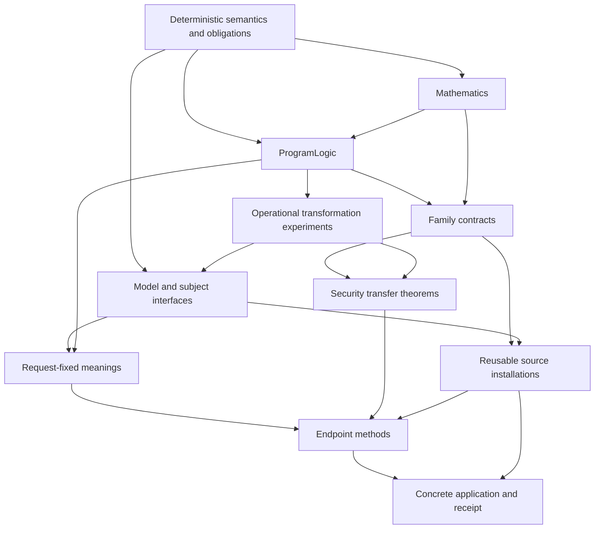

# Architecture

zkc separates an admitted program, its interpretation, the mathematical
contract, a requested property and the proof of that property. The same source
correspondence can support honest completeness and adversarial soundness;
these properties retain different hypotheses and conclusions. A method finds
a proof of an already fixed meaning. It cannot choose that meaning.

The deterministic core owns the original-IR behavior and exact per-role
correspondence. Security adds probability, protocol mathematics and
property-specific transfer. Metaprograms propose ordinary proof terms. Python
schedules generation, kernel checks and reports; it does not interpret a
second security semantics. Frontend elaboration and native byte rendering
remain named correspondence boundaries under the
[verification scope](support.md).

## Packages and library roots

A Lake package fixes dependencies and optional integration. A library root
selects owned modules and build targets. Neither is a security theorem or an
access-control mechanism: the import and stored-declaration audits enforce the
responsibility boundaries.

| Package | Reusable theory | Proof construction | Concrete applications | Dependencies |
|---|---|---|---|---|
| `lean/` (`zkc`) | `Zkc` | `ZkcTools` | `ZkcExamples` | Mathlib |
| `lean/security/` (`zkc_security`) | `ZkcSecurity` | `ZkcSecurityTools` | `ZkcSecurityExamples` | Core, VCVio, PolyFun, CompPoly, Mathlib |
| `lean/integrations/arklib/` (`zkc_arklib`) | `ZkcArkLib` | Its adapter modules | `ZkcArkLibExamples` | Core, security, ArkLib and coherent shared pins |
| `lean/integrations/clean/` (`zkc_clean`) | `ZkcClean` | Its adapter modules | `CleanExamples` | Core, Clean and coherent shared algebra pins |

Each package also owns its tests. All maintained libraries, tools, examples and
tests remain default targets. Core does not require the security ecosystem;
security does not require ArkLib or Clean. Integration packages stay optional.
There is no additional `Security` directory inside `ZkcSecurity`, and no package
per protocol family.

Import paths describe module ownership. Declaration namespaces are independent
Lean names. Moving a module does not require renaming its theorems, creating
aliases, or retaining an old import. Generated-module descriptors likewise
separate import paths from declaration namespaces. There are no forwarding
modules for the retired paths.

## Deterministic responsibilities

| Area | Owns |
|---|---|
| `Zkc.Semantics` | `Process`, outcomes, execution, observations, refinement and continuation laws |
| `Zkc.Source` | Typed retained source, participant operations, domain meanings, admission and verified normal forms |
| `Zkc.Construction` | Compiled participants and exact source/participant correspondence certificates |
| `Zkc.Executable` | The admitted program representation, executable meaning and checked lowering rules |
| `Zkc.Obligations` | Probability-free derivations, component contracts, connections and loop interfaces |
| `Zkc.Protocols` | Deterministic protocol mathematics and reusable source-template laws |
| `Zkc.Claims` | Request wire data and structural claim vocabulary |
| `ZkcTools` | Readers, certificate builders, tactics and companion discovery |
| `ZkcExamples` | Exact exported artifacts, selected Entries and their application proofs |

Structured participant meanings use typed sends, receives and service queries.
Role masks, absent values, reached stops, complete returned rows and occurrence
coordinates remain in their semantics. A source template is reusable when its
interface accepts arbitrary checked definitions or body-membership laws. A
proof fixed to a closed exported payload belongs to the application, even when
its source algorithm is familiar.

## Six security responsibilities

`ZkcSecurity` has six areas. These are responsibility groups, not six indivisible
build layers or a linear import chain.

| Area | Inputs and results | Excludes |
|---|---|---|
| `Mathematics` | Probability, finite distributions, algebra and reusable oracle laws | Selected Entries and receipt policy |
| `ProgramLogic` | Quantitative derivations, charged transcript judgments, honest execution and game relations | A protocol's slot layout or selected request |
| `Families` | Abstract Sumcheck, Sigma, GKR, proximity and STARK mathematics and contracts | Exact generated subjects and implementation routing |
| `Transformations` | Fiat–Shamir, commitment and provider experiments and their security transfer theorems | Family dispatch and receipt resolution |
| `Bindings` | Domain capabilities, actual-subject interfaces, reusable source installations, representation and readback laws | Closed flagship proofs and evidence-chosen security meanings |
| `Claims` | Fixed meanings, registry resolution, receipts and method-specific endpoint assembly | A substitute verifier or extractor selected by evidence |

For example, Sumcheck's abstract contract lives in `Families.Sumcheck`.
Table representations and source-template equations live in `Bindings.Sumcheck`.
Closed SmallSumcheck and TwoSums selections live in `ZkcSecurityExamples`.
GKR's mathematical circuit identities are family mathematics; a representation
law relating source tables to that circuit is a binding; a theorem about the
exact exported GKR pair is an application. These are three different artifacts.

Small interfaces precede assembly modules within the same area. In particular,
actual carrier capabilities are below model resolution, and an operational
extraction experiment is below its Sigma justification. Registry description
data can name schemas without importing their definitions; the package audit
checks those names against their actual providers.

### Knowledge meanings and methods

A knowledge request fixes the actual compiled verifier, adversary interface,
challenge occurrence, resource bound, retained relation, witness embedding and
registered recovery function. The response-difference extractor and its failed
fork behavior are part of that experiment. A Sigma-family theorem justifies
the fixed experiment; it is not an input that evidence can use to redefine it.

The lower transcript and extraction definitions live below `Claims.Knowledge`.
The Sigma justification and endpoint assembly live in `Claims.Methods`.
Importing a fixed meaning therefore does not import a particular knowledge
proof method. The actual replay cache, unsuccessful-fork sampling and verifier
query behavior are preserved by this separation.

### Component connections and transformation boundaries

A `ComponentInterface` separates logical parameters from executable inputs.
A `ClaimRelation` may leave a gap between Yes and No. Partial readbacks do not
turn malformed values into mathematical witnesses. A `Connection` relates an
installed callee to its caller using an explicit parameter map, value readback,
occurrence route and commuting equation. Yes and No transport use their own
laws; a shared equation does not imply independent randomness.

Commitment realization is a security transformation, not another representation
layout. Its quantitative theorem bounds a named checkpoint event. An
application additionally proves that its requested failure implies that event,
including the designated key's occurrence in the actual verifier query log.
An empty verifier log cannot silently establish application adequacy.

## Dependencies, proof tools and visibility

One policy in `ZkcTools.DeclarationAudit` drives both source-import and
stored-declaration checks. They cover transitive dependencies, private and
generated declarations, proof bodies and axiom closures. Package checks also
verify exact Lake ownership, dependency pins and complete default targets.
There are no retained dependency exceptions.

Reusable theory, generic methods and adapters cannot import closed examples.
Lower mathematical and semantic interfaces cannot import endpoint assembly.
Family methods can consume the family's completed API; a family theorem cannot
import its own method catalogue. Generic proof tools may be used in proofs
when their dependency layer stays below that theorem. This is separate from
whether a tool is ordinary or meta code.

Lean's `public import` controls exported interfaces, and `public meta import`
exports elaborator implementations. Neither replaces the semantic dependency
policy. Import evidence retains the public, meta and import-all flags. External
clients check both theorem-only use and invocation of a tactic through a public
facade. Definitions needed in dependent types and certificate checking keep
their existing exposure; this organization does not impose a broad opacity
change or promise a checking-speed improvement from directory moves.

Start a mathematical Sumcheck client with `import ZkcSecurity.Families.Sumcheck`.
Start a component proof-construction client with
`import ZkcSecurityTools.Components`. Import a particular binding separately
when instantiating an admitted source template. Concrete generation drivers and
catalogues live with their applications; generic printers accept descriptors
rather than importing the maintained subject list.

## Structured proof construction

Retained declaration contracts and explicit formula links belong to original
PIR and the independently admitted snapshot. They do not change executable
participant operations. Selected-Entry metadata refers to the canonical owned
target clause; component contracts remain reusable at ordinary protocol calls.

`Structured.ContractBinding`, `ContractBoundary` and `ContractMeaning` connect
those declarations to typed port/role selections and actual formula invocation.
Logical assignments are scoped by owner and explicit invocation labels; those
labels do not prove dynamic reachability. A shared interpretation
environment fixes opaque relation meanings. `ContractExecution` projects
boundaries from actual outcomes, preserving absent participants and stops.
`ReplyScript` fixes the replies of one role-local run by type and site, so a
transcript's actual returned outputs and ordered sends can be observed; it is an
experiment choice, not a provider law.

`Structured.UnitViews` emits a unit's literal checked payload from its typed
bodies: `structured_views` writes the checked declarations, the payload and one
named kernel equation per admission phase, ordering declarations with the
admission orderers themselves; `structured_associations` writes each body's
membership, signature and raw-tree association. The commands produce ordinary
declarations, so a stale or mistyped body fails a phase equation. Phase
equations use `kernel_rfl`, which checks a definitional equality in the kernel
only, for every value of the goal's binders at once.

`Bindings.RoleViews` derives the participants' complete normal forms from the
admitted typed source. Lean catalogues select snapshots and display names;
source scopes determine input visibility, callback frames and callee arguments.
Each emitted equation applies the verified normalizer's soundness theorem.
Occurrence coordinates, missing inputs, arbitrary replies, stops and complete
returns remain in the statement. `bridges/structured/source_views.py` only
schedules Lean generation and compares output files. Mathematical helper laws,
loop invariants and security reductions remain explicit library obligations.

`Source.RegionDerivation` and its tactics derive process correspondence from the
same typed body using local rules. `Structured.ContractCalls` enumerates lexical
calls; `ContractComposition` proves actual callee substitution and continuation
laws. `ContractObligations` records selected mathematical uses, residual or
terminal requests and call coverage. It does not select a security experiment.
Optional library consumers supply that experiment and its proved transport.

The [design rationale](design/protocol-verification.md) explains why structural
proof construction, logical interpretation and property application have separate
owners. [Verification](spec/verification.md#structured-contracts) defines their
proof obligations.

## Reuse and composition

A source certificate proves exact equality of an open process, including all
requests and continuations. It can therefore be reused under deterministic,
stateful or probabilistic handlers. Schnorr's same certificate supports
completeness, special soundness, a custom rejection property, and VCVio simulation.
Original, helper-based and reordered sources reuse these consumers. Sumcheck's
original, helper-based and Horner forms reuse finite soundness and ArkLib's
reached-query probability experiment.

Sequential refinement uses `ExactRefinement.bind_congr`; execution threads the
actual successor state and concatenates ordered events. `Common.ResidualContract`
connects Sumcheck rounds to a terminal checker. `FactorOpening` composes rounds
with adaptive factor replies and an explicit bad-opening event. Its conditional
bound is the Sumcheck error **plus** an opening error bound; independent events
are not assumed. Public polynomial checks prove that opening error is zero.
A PCS needs its own proved opening consumer and assumptions.

This supports many compatible source × contract × property combinations.
Incompatible views, adversary access or sampling policies need an explicit
adapter theorem. Adding one consumer does not promise that it applies to every
contract. A downstream Lean module can define a property and consumer directly;
`CustomProperty.lean` demonstrates this without editing the CLI registry.
