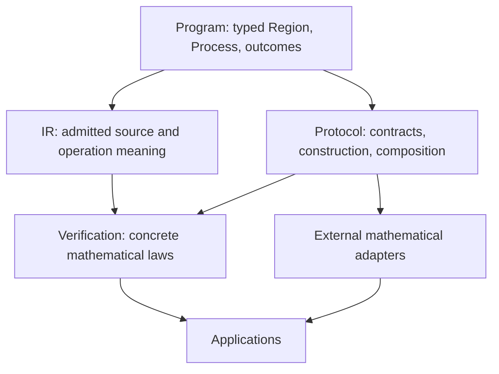

# Formal architecture

The single semantic foundation is `Zkc.Source.Region` interpreted into `PIR.Process`.
Both are owned by Program. The Protocol framework and concrete IR interpretation
depend on this foundation independently. Verification connects reusable mathematics
to concrete meanings; adapters import explicit external libraries; Applications
contains downstream consumers. Package roots and dependency rules are enforced by
the [package inventory](../support/packages.py) and stored-declaration audit.

## Proof boundaries

1. Source admission fixes the actual typed definitions, arguments, captures, roles,
   services and outcomes. It does not select their mathematical interpretation.
2. Mathematical interfaces state laws under explicit representation and admissibility
   premises. Pure value equations require a proved pure/total domain; effectful laws
   preserve state, history, stops and probabilistic behavior.
3. Common construction composes laws over the actual Region meaning. It handles
   structure; authors supply mathematics and meaningful invariants.
4. Installation connects a selected implementation and interpretation. A fixed claim
   then consumes the installed evidence. Law coverage and claim validity are distinct.

The generic framework is maintained. Complete native actual-source installation,
generated-controller correspondence and new protocol applications are separate open
boundaries. There is no retained old connection route to fill those gaps implicitly.

## Module and validation ownership

Public library modules use Lean's module system. Tools and audits explicitly load
the private stored declarations needed for provenance and axiom checking. Module
paths determine ownership; declaration namespaces are independent and do not grant
an import edge. Companions depend on templates, never the reverse. Native transport
mutation helpers live with native tests, not in a Lean source generator.

Use focused incremental builds while changing proofs. At a package boundary,
refresh affected declaration/axiom records and required external consumers once.
See [module ownership](development/module-ownership.md), [independent checking](development/independent-checking.md)
and the [support boundary](support.md).
