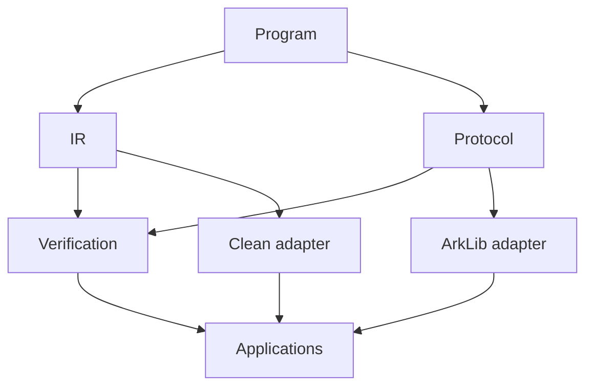

# Formal architecture

The Lean development has four semantic owners: **Program**, **IR**, **Protocol**,
and **Verification**. These are independent Lake packages with exclusive module
roots. Optional adapters and concrete applications sit downstream. `lean/` is the
shared documentation and checking workspace, not another semantic package.

```text
lean/
  program/        Zkc/Program/             shared program semantics and mathematics
  ir/             Zkc/IR/                  concrete compiler IR and checked connections
  protocol/       Zkc/Protocol/            protocol contracts, claims and reusable laws
  verification/   Zkc/Verification/        actual IR subjects and claim interpretation
  adapters/
    arklib/       Zkc/Adapters/ArkLib/     external family mathematics and correspondence
    clean/        Zkc/Adapters/Clean/      external AIR representation correspondence
  applications/   Zkc/Applications/        maintained protocols, companions and receipts
  checks/                                 shared validation drivers
  support/                                package inventory and evidence tooling
  docs/                                   formal specifications and architecture
```

Within each package, `Zkc/Tools/<Owner>/` contains elaborators, printers and audit
commands, and `Zkc/Tests/<Owner>/` contains controls. Tools and tests have separate
Lake targets; they are not additional semantic layers. Concrete retained exports
and generated proof modules are under their application, separated from its
mathematical companion by the existing `Generated` subdirectories.

## Ownership and dependencies

| Owner | Owns | Must not depend on |
| --- | --- | --- |
| Program | `Process`, `Region`, typed environments, deterministic interpretation and generic execution laws; shared algebra and polynomial data | IR, protocol proofs, VCVio, adapters, concrete applications |
| IR | Deeply embedded compiler vocabulary, strict readers, admission, actual participant execution and source/participant correspondence | Protocol mathematics, verification policy, adapters, applications |
| Protocol | Fixed mathematical property meanings, probability/effect interpretation, component contracts, installation, representation, composition and reusable family mathematics | Concrete compiler IR, actual subjects, adapters |
| Verification | Request interpretation and actual-IR security methods, representation installations and generic claim assembly | Optional adapters or concrete applications |
| ArkLib adapter | Correspondence from pinned external mathematical models to reusable public contracts | IR, verification, concrete applications |
| Clean adapter | Correspondence between external AIR representation and zkc IR | Protocol proofs, ArkLib, verification, applications |
| Applications | Actual exported subjects, selected adapters, mathematical companions, concrete installations and receipts | No upstream package may import it |



An arrow means “is available to”. Shared polynomial operations belong in Program
because both IR interpretation and protocol mathematics use them. Program's
`Interaction` and `Region` core is Lean/Std-only by an import guard; its mathematical
support may use Mathlib. Package independence and a minimal module import closure
are distinct properties. VCVio and PolyFun belong to Protocol's implementation of
probabilistic interpretation, rather than replacing the public `Process` model.

The inventory in `support/packages.py` owns source locations, full module prefixes,
selection and package dependencies. The policy in the Program declaration-audit
module owns admissible module and proof-body dependencies. Both source checks and
stored-declaration checks enforce the policy. There are no compatibility modules,
forwarding roots or duplicate physical providers for a maintained module.

## Imports are not declaration names

Lean identifies a module by its path relative to a Lake package. A declaration's
namespace is independent. For example, a client imports
`Zkc.Program.Interaction` to use `PIR.Process`, and imports
`Zkc.Protocol.Claims.Assembly` to use `ProtocolProof.Installation.ofMap`.

This migration preserves established declaration names and theorem bodies. It
changes their physical and import ownership. Printers and subject descriptors name
both the module to import and the declaration namespace to reference; they must
not derive one from the other. A future declaration rename is a separate API
change, not a reason to add compatibility import paths here.

## Adding reusable mathematics and actual clients

A new protocol-independent lemma or component contract goes in Protocol, normally
`Zkc.Protocol.Library`. A reusable adapter for an external library proves the
mathematical representation law there or in its optional adapter package. An
actual source-specific installation belongs in Verification when it is reusable
for arbitrary admitted IR; a selected protocol instance belongs in Applications.

Authors supply mathematics, invariants, representation relations and explicit
security premises. The common generators assemble structural derivations. Moving
a module does not prove that every remaining authored connection is automated;
that is an independently measured property of the construction APIs and clients.

Soundness, completeness, knowledge and privacy share installation and composition
infrastructure but keep their distinct fixed meanings and quantified premises.
No theorem claim is inferred from directory placement, successful parsing, a
registry name or the existence of a proof method.

## Standalone elaboration and downstream consumers

Lake builds resolve the exclusive dotted module roots through complete module
identities. Standalone generated files use `support.invocation.command`, which
obtains the selected package's `ModuleSetup` from Lake and passes exact artifact
providers to Lean. A raw `LEAN_PATH` search by its first component cannot resolve
several independent packages that all begin with `Zkc`. The invocation helper
preserves explicit overlay precedence, private import visibility, the package's
pinned toolchain, and existing failure and timeout controls.

Every reusable package has an external Lake client in `lean/clients`. The audit
policy gives the standalone `Client` module an explicitly downstream-only layer:
it may use the maintained packages, but no maintained package may depend on it.
Executable modules are declared separately and audited in isolated environments,
so unrelated global `main` declarations never share an audit environment.

## Validation and maintenance

1. Run source ownership, import coverage and dependency checks before long builds.
2. Build changed targets in their owning package, using explicit `+Zkc...` module
   targets for a focused iteration.
3. At a landing, build affected packages with strict warnings and inspect their
   exhaustive declaration/axiom audits and protected statement comparison.
4. Regeneration must preserve declaration identity and emitted mathematics while
   reading current module paths. Keep actual source/native reports separate from
   source-only and module-build evidence.

Do not create a root Lake library with `Zkc.+`: it would claim every downstream
module. Package libraries explicitly own only their reviewed full prefixes.

The proof/report registry modules belong to Verification and Applications.
Their quoted schema names are registrations, not imported mathematical proofs;
a pure adapter does not depend on a concrete receipt catalog. Complete registry
schema checking runs with the actual subjects loaded in Applications. Independent
command entry points use separate audit environments, preserving complete source
coverage without combining unrelated global `main` definitions.
