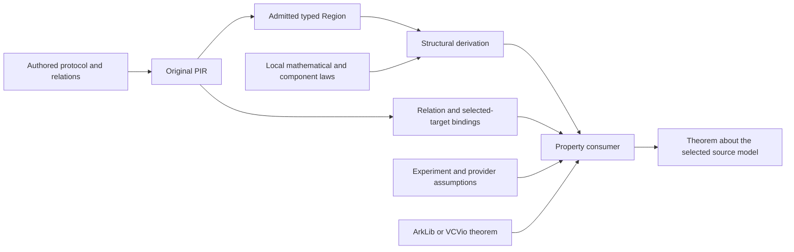

# Research design: source-bound protocol verification

## Question

How can security theorems from independently evolving libraries be reused for
varied authored protocol programs, while keeping the program, intended relation,
experiment assumptions and theorem application tied together?

## Chosen structure

Retain contracts at the original-PIR boundary and derive behavioral proofs from
the existing typed `Region`. The region denotes one role-local open process in
`PIR.Proc`. Relation interpretation and property-specific library adapters use
that same subject. The [verification specification](../spec/verification.md#structured-contracts)
owns the detailed interfaces; [support](../support.md) states theorem scope.

The source language records mathematical intent: relations, component boundaries,
ports, roles and selected targets. It does not need to encode a particular
library's theorem names or its entire security logic. Lean supplies invariants,
mathematical interpretations, logical parameter instantiations and the selected
experiment. This keeps a protocol reusable across completeness, extraction,
acceptance bounds and simulation, which have different quantifiers.

### Source syntax and proof authoring

The existing `relation` and `spec` forms remain because they express the facts
that compilation must retain: an actual predicate body, its argument order,
participant-local ports, and the intended target or residual. Their current
spelling is not an architectural requirement. In particular, an `input` clause
describes an input relation; a false-claim soundness experiment may refute that
relation rather than assume it.

Proof authoring currently uses Lean. An adapter supplies a mathematical
interpretation, local adequacy laws and an experiment; deterministic binding
data can be recovered from the retained declarations. This separates semantic
choices from indices and duplicated source structure. A later verification
declaration in `.zkc` could select these adapters and instantiate their typed
parameters, but it should elaborate to these same obligations. Library names,
annotations and successful elaboration cannot replace the corresponding proofs.

### Alternatives and the automation boundary

| Approach | Useful role | Main cost or limitation |
|---|---|---|
| Recognize a complete exported protocol | Optional automation for familiar small programs | Factoring and syntactic changes can break recognition; arbitrary semantic equivalence is not decidable |
| Generate both programs and proofs from a restricted language | A possible frontend for verified component libraries | Introduces another translation boundary and can restrict custom implementations |
| Prove local component contracts and instantiate actual calls | Reuse behavior across callers and source arrangements | Each new implementation still needs a local correspondence proof |
| Derive obligations over the existing typed Region | Recover binding and composition mechanically | Mathematical invariants, domains and experiment choices remain explicit |

The implementation combines the last two approaches. This preserves one
execution semantics and lets recognition or future syntax elaborate into the
same checked evidence. The automation boundary is practical: recover source
identity, selectors and structural composition; ask the author for mathematical
laws and the experiment they intend to prove.

A source annotation can identify a residual obligation or a shared mathematical
parameter. It cannot establish that the executable continuation discharges that
obligation. That connection needs a theorem about the continuation's actual
returned observation. Conversely, a relation-free component can still have a
behavioral proof; annotations are not a prerequisite for interpreting its code.

### Why composition rather than whole-program recognition

Recognizing a familiar protocol after export can be useful automation. It is a
poor ownership boundary: helper factoring, role permutations or a different
terminal checker can invalidate a syntactic pattern without changing the intended
mathematics. Reusable component laws instead connect exact bodies and signatures
to behavioral interfaces. Proved call rules instantiate them at actual operands
and return their results to the actual continuation.

For probabilistic composition, a caller may use a child's residual bound if its
continuation can accept only when that residual holds. The maintained bind rule
checks this implication for arbitrary returned values and intermediate states.
Sumcheck uses it at the actual call boundary: the terminal checks the fixed
table and returned point/value; only the child's own theorem examines its round
implementation. A replacement-child control exercises the same caller theorem
with a different body. This is the reusable interface that a shared expansion
of both bodies would not provide.

A proof-producing tactic recovers the structural spine from the admitted tree.
Its candidate is checked by Lean; unsupported mathematics remains a goal. This
is intentionally narrower than discovering invariants or deciding arbitrary
program equivalence. A new language that generates both code and library proofs
could provide a convenient restricted frontend later, but would still need this
underlying correspondence boundary.

The bounded scalar generator remains useful for its reviewed source vocabulary.
It is a client of explicit proof requests, not the definition of all possible
contracts or theorems. Likewise, a supplied whole-program equality is a useful
final certificate only after its derivation is available; wrapping that equality
in a record does not automate the connection.

### Why three kinds of evidence remain separate

| Evidence | What it establishes | What still needs a proof or explicit choice |
|---|---|---|
| Retained and admitted structure | Exact body, formula link, selected target, operands, role substitution and call inventory | That the imported model corresponds to native source and execution |
| Local mathematics and process laws | Formula adequacy on its domain; component behavior; actual returned or stopped observations | Reachability, loop invariants and required local premises |
| Property consumer | A result under the chosen experiment and library theorem | The intended adversary, fixed parameters, sampling, state and terminal assumptions |

A Sumcheck table used as the mathematical reference must remain fixed even when
an adversary supplies a different runtime table. An extracted Schnorr witness
must be inserted into the actual source relation without assuming the original
prover witness was known or valid. These examples rule out deriving logical
authority or quantifiers from port availability alone.

Calls and repeat iterations also need distinct logical invocation identities.
Reusing input index zero in two components does not share their parameters.
Explicit instantiation can share one table or one extracted witness when the
property requires it. Opaque relation meanings are fixed once per experiment,
so repeated uses of one declaration cannot choose unrelated predicates.
The current coordinates are logical labels. A theorem about dynamic invocation
reachability must additionally connect those labels to the actual execution.

### Failure and observation are part of the interface

A stopped process has no returned acceptance or residual tuple. Structural laws
preserve stops, earlier events and residual provider state; a property consumer
selects its observation from actual execution. A verifier can refuse every input
and satisfy a soundness bound while failing completeness. The API therefore
keeps those properties separate instead of treating one Boolean certificate as
all of protocol correctness.

Exact open-process equality is a useful reusable intermediate result. It may be
too strong when an optimization changes hidden events or sampling structure.
The maintained local VCVio coupling transports the same process under two
handlers and observation views, with exact paired replies and outcomes and an
explicit state relation. Relating different sampling programs requires a
further coupling proof. An event-erasing map or distribution equality must
establish what the chosen property actually observes.

### Theoretical basis and limits

[Interaction Trees](https://arxiv.org/abs/1906.00046) demonstrates compositional
reasoning with events, continuations and handlers. zkc uses its existing finite
process model; it does not adopt the paper's coinductive semantics or claim
support for arbitrary nontermination.
[Dijkstra Monads for All](https://arxiv.org/abs/1903.01237) explains how distinct
specification interpretations can relate to one computation semantics. This
motivates separate property consumers rather than one interpretation of clause
kinds as universal preconditions and postconditions. These papers inform the
architecture; the maintained Lean laws establish its particular claims.

The strongest feasible completeness claim is relative to an explicit proof
construction: all structural occurrences are covered and all selected leaves
are discharged. It cannot certify that the author declared every intended
security property. General library correspondence and invariant inference remain
mathematical work, even when parsing, binding and structural composition are
mechanical.

## Evaluation and falsification

Evaluate admission, semantic correspondence, security transport and native
adequacy separately. Positive examples must be actual exported subjects.
Negative controls should change protocol timing, residuals, selectors, relation
bodies, effect sites, domains, probability models and certificate subjects.
Check the checker itself with forbidden axioms and valid proofs about different
programs. Audit transitive proof dependencies rather than upstream build warnings.
Differential execution compares complete observable prefixes using an independent
native SSA interpreter; it supplements but never replaces theorem checking.

The architectural review asks whether generic consumers import particular
examples and whether each new source requires duplicating every theorem. The
semantic review examines role-local availability, termination, observation
budgets, state and stop distinctions. The proof-chain review reconstructs all
source-to-game equalities and external theorem premises. The generator review
reconstructs the requested subject independently of candidate aliases.
Independent read-only agents also reviewed the foundations and external theorem
candidates; this does not constitute a human external audit.
The [implementation review](review.md) records the reviewed boundaries, findings
and their resolutions.

## What remains open beyond the implemented profile

### Generic relation authoring

Generic formula relations already give reusable source libraries an inspectable
predicate. Opaque relations currently require a fixed logical signature. The
Sumcheck residual therefore uses a typed external Lean request: it names the
fixed original table and reads the actual returned point and value. Moving that
request into a source-authored generic continuation is useful follow-up work,
but does not by itself strengthen the probability theorem.

A generic opaque family needs more than permission to parse static parameters.
Its closed instance identity must include every normalized static argument,
including arguments absent from the native ABI. Source emission and independent
source comparison must derive the same identity; exact logical schemas and
purposes must still agree. Repeated uses of one instance need one interpretation.
Distinct declarations treated as aliases need explicit coherence, which the
current per-declaration relation environment does not infer.

A bounded extension can emit closed instances through the existing relation
carrier. Automatic proof-library selection from standalone exports additionally
needs checked family/argument provenance and logical ABI information. A digest
alone cannot recover those arguments or establish a theorem's applicability.
Evaluate the extension by replacing the maintained Sumcheck external residual
with an actual retained continuation and consuming its equivalence in the same
final probability bound. Merely retaining another annotation is insufficient.

### Further semantic coverage

Observation-specific refinement must state which events and resources it may hide.
General native control, waiting schedulers, production fields/groups, provider
randomness, DSL compiler correctness and lower-stage preservation require their
own adequacy proofs or maintained tests. General PCS, Fiat–Shamir and concurrent
zero-knowledge composition need appropriate external theorems and adapters.
A generic automation claim must quantify the supported contract language and
state what obligations remain when normalization does not succeed.

The implementation is an extensible research baseline, not an assertion that
all programs can be automatically proved safe. New protocol families should be
chosen to falsify the interfaces: variable-round protocols, stateful commitments,
lookup arguments and different adversary/query structures are useful tests.
Research can adjust package boundaries when these tests expose a concrete need.
