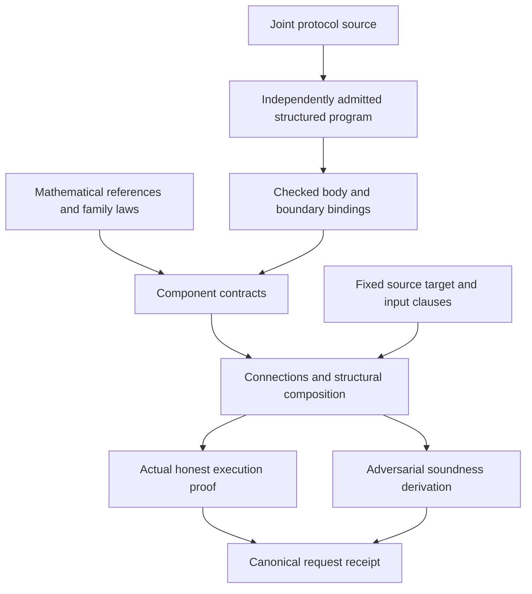

# Authoring proofs from reusable components

The source program fixes the execution and its relation applications. A Lean
library supplies mathematics and proofs about that execution. Generated bindings
connect the two. A receipt proves the request's fixed meaning; a method cannot
replace the relation, verifier, extractor, model or requested stage.

## Choose what is new

| Change | Author-owned mathematics | Reused infrastructure |
|---|---|---|
| Compose installed components | Root target coverage and any new connection law | Body binding, call/role routing, composition and request checking |
| Change a representation | Decode/readback, helper and update laws; exact sampler law if it changes | The existing mathematical reference and family security theorem |
| Add a family | Reference, honest computation, invariant or certificate, bad-event bound and terminal adequacy | Process semantics, derivation rules, fixed meanings and receipt checking |
| Add a proof method | A proof of the existing meaning, possibly using a checked certificate | The same request and property semantics |
| Add a security property or execution stage | A separately reviewed fixed meaning and its correspondence laws | Registration and receipt machinery after that meaning is installed |

These categories describe responsibilities, not a promise that every source
shape already has a generator. An unsupported shape must produce an explicit
obligation or refusal. A new method is an ordinary indexed Lean proof; it does
not require global type-class search or a second interpreter.

## Define the mathematical boundary

[`ClaimRelation`](../../Zkc/Obligations/ClaimRelation.lean) separates an
affirmative witness relation from `No`. Exact relations can use the complement
of validity. Proximity contracts instead retain a gap: a word can be outside the
code without being far enough for the soundness theorem. Matching affirmative
predicates alone does not justify transporting `No`.

A source relation has one fixed interpretation. A formula uses its admitted
Math body. An opaque relation uses an installed registry entry with the exact
family, version, typed static arguments, flattened ABI and argument purposes.
That installation belongs to the mathematical library. Evidence supplies a law
about the installed interpretation, rather than a replacement predicate.

The reference can come from a checked analysis of the joint program, an installed
component or authored mathematics. Honest-producer correspondence proves that
the actual producer computes this reference on valid inputs. It does not make
whatever the producer happens to compute the definition of truth. GKR's circuit
evaluation and the separate extensions of its four gate factors illustrate why
this distinction matters.

## Bind one component

[`ComponentInterface`](../../Zkc/Obligations/Component.lean) records:

- the actual `PIR.Process` body and its runtime arguments;
- logical parameters and input/output claim relations;
- a scope over the runtime arguments and reached transcript history;
- partial input and output readbacks, returning `Option`.

Logical parameters can contain an original table or circuit used in a proof.
They do not become verifier-readable inputs. A missing runtime observation is
`none`; it cannot be replaced with a convenient mathematical value.

`SoundnessContract` consumes both the actual scope and a defined input `No`, and
produces a derivation for the output `No`. `SoundnessContract.ofFamily` reuses a
family through an exact body equation and checked entrance/exit implications.
The same body equation is available to honest execution proofs. It covers all
replies and stops, rather than only a successful trace.

For Sumcheck, the reusable reference is the residual sum after a prefix; the
family proves the round polynomial's boundary, degree and evaluation laws. A
representation supplies the concrete message/readback and restriction equations.
For GKR, the split-variable layout proves which factor is independent of the
active variable. A generic four-factor product cannot silently inherit the
degree-two bound.

## Prove the connections explicitly

A `Connection` contains an actual runtime route, a mathematical statement map
and a commuting readback equation. Its honest and sound uses share that equation
but require different logical laws. A matching field type is not a connection
proof: swapped claims, points or circuit layers can have identical types.

Pure helper conversion needs its actual helper equation, an operational domain,
defined readback in that domain, and preservation of the selected relation.
Opening or repacking a pending claim carries its obligation forward. A terminal
law explains why the actual returned accepting value discharges that obligation.
A conversion that queries an oracle or samples a challenge is a component with
its own execution and cost law.

The caller must establish the next scope at the reached state. In a conjunction,
the first component might process a true claim while only the second claim is
false. Therefore frame and scope preservation cannot depend on the first
claim's `No`. The generic
[`Assembly`](../../Zkc/Obligations/Assembly.lean) rules retain this independent
premise, both return values and the complete history. Honest composition likewise
threads actual producer/verifier state and the shared cache; a cold-start success
theorem for each component is insufficient.

## Close the root and inspect the receipt

The root supplies coverage from its fixed false target to the component
obligations, and an adequacy law from the final residual to actual acceptance.
Completeness additionally supplies the actual honest producer and input
preparation, including all failure and stopped mass. Structural generation can
assemble installed laws; it cannot invent a new polynomial identity, degree
bound, sampler law, application relation or extraction algorithm.

Inspect the request's property, model, target, input policy, stage and error
before interpreting `established`. A source-process theorem, an ideal compiled
receipt and a byte-level execution theorem have different correspondence
requirements. Cryptographic assumptions and stage links remain visible even
when the component proof is reused.

The [selected property adapters](../spec/selected-property-adapters.md) give
concrete limits: KZG's unconditional reduction and opening client are component
results; fixed two-cell recovery is a separately registered extraction property.
Neither supplies general computational hardness or committed-oracle knowledge.

When measuring author work, include reference/helper proofs, relation and
connection laws, configuration and generator extensions. Generated source size
and kernel checking cost are separate measurements. Moving a proof into a helper
does not make that work disappear.
