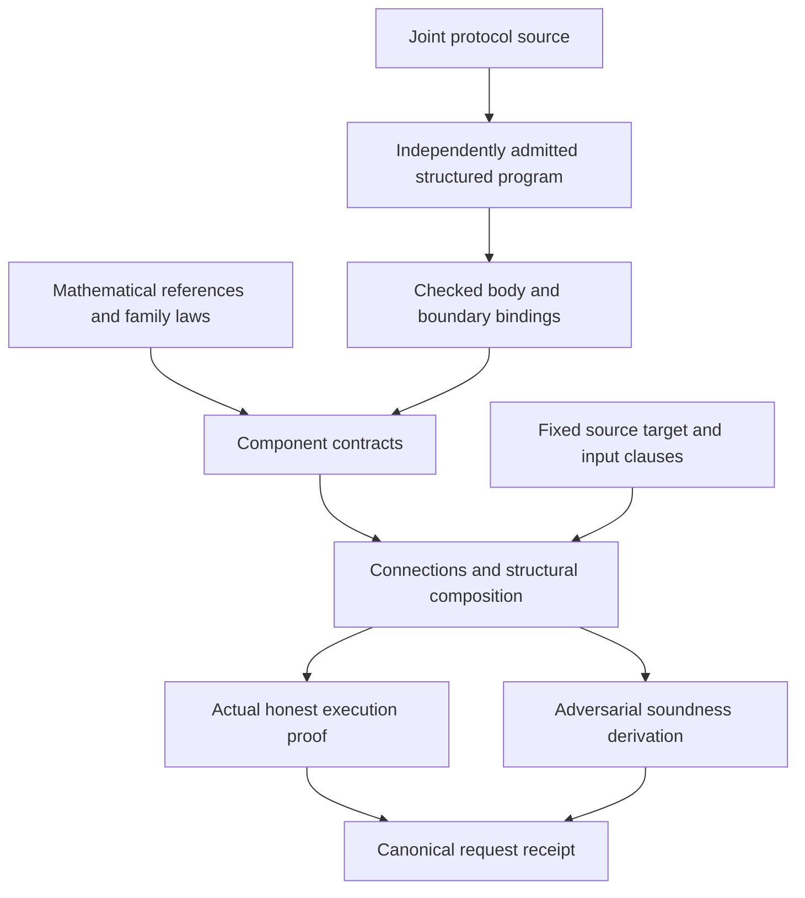
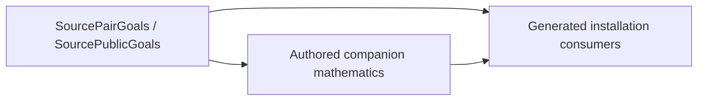

# Authoring proofs from reusable components

The source program fixes the execution and its relation applications. A Lean
library supplies mathematics and proofs about that execution. Generated bindings
connect the two. A receipt proves the request's fixed meaning; a method cannot
replace the relation, verifier, extractor, model or requested stage.



## Choose what is new

| Change | Author-owned mathematics | Reused infrastructure |
|---|---|---|
| Compose installed components | Root target coverage and any new connection law | Body binding, call/role routing, composition and request checking |
| Change a representation | Decode/readback, helper and update laws; exact sampler law if it changes | The existing mathematical reference and family security theorem |
| Add a family | Reference, honest computation, invariant or certificate, bad-event bound and terminal adequacy | Process semantics, derivation rules, fixed meanings and receipt checking |
| Add a proof method | A proof of the existing meaning, possibly using a checked certificate | The same request and property semantics |
| Add a security property or execution stage | A separately reviewed fixed meaning and its correspondence laws | Registration and receipt machinery after that meaning is installed |

These categories describe responsibilities, not a promise that every source
shape already has a generator. An unsupported shape must produce an explicit
obligation or refusal. A new method is an ordinary indexed Lean proof; it does
not require global type-class search or a second interpreter.

## Define the mathematical boundary

[`ClaimRelation`](../../Zkc/Obligations/ClaimRelation.lean) separates an
affirmative witness relation from `No`. Exact relations can use the complement
of validity. Proximity contracts instead retain a gap: a word can be outside the
code without being far enough for the soundness theorem. Matching affirmative
predicates alone does not justify transporting `No`.

A source relation has one fixed interpretation. A formula uses its admitted
Math body. An opaque relation uses an installed registry entry with the exact
family, version, typed static arguments, flattened ABI and argument purposes.
That installation belongs to the mathematical library. Evidence supplies a law
about the installed interpretation, rather than a replacement predicate.

The reference can come from a checked analysis of the joint program, an installed
component or authored mathematics. Honest-producer correspondence proves that
the actual producer computes this reference on valid inputs. It does not make
whatever the producer happens to compute the definition of truth. GKR's circuit
evaluation and the separate extensions of its four gate factors illustrate why
this distinction matters.

## Keep source facts independent of the proof method

The core `Zkc.Source.Structured` modules own input visibility, source-template
association, occurrence presentation and loop presentation. Their theorems have
no probability or security-package dependency. A mathematical library can reuse
these facts for either participant, with the full returned row and visibility
mask preserved. Construction certificates use the same visibility laws when
connecting the source to its compiled participant.

Mathematical family laws live under `ZkcSecurity.Families`. Adapters that read
particular source templates, layouts or exported programs live under
`ZkcSecurity.Bindings`, even when that adapter is reusable across several
programs in one family. For example, the Sumcheck source adapters reuse its table
mathematics without making the mathematical family import concrete programs.
Restricted proof elaborators may be shared by these layers; source emitters and
example catalogues remain outside the mathematical dependency boundary.

A displayed process is a derived view. The untrusted `ZkcTools.ProcessView`
elaborator checks definitional equality to its input expression; it supplies no
separate evaluator. The present-input printer additionally emits a theorem from
the admitted source to its checked normal form. That theorem covers the selected
available-input pattern. Adversarial claims must use the appropriate optional
input pattern and cannot infer universal input availability from this view.

## Install source presentations and counted loops

An installed source family binds exact helper bodies, including the helpers
they call. A matching helper name or type is insufficient. `BodyIn` records
the association with the admitted definition list; `bind_structured_bodies`
constructs these associations against that list. The mathematical family is
parameterized over the definitions and names, so a new Entry can reuse it.

The [TwoBatches fixture](../../fixtures/reusable-aggregate/README.md) illustrates
this boundary. Its root signature and typed body come from the body printer.
The author selects the reusable batch helpers, installs their associations,
and states how the two mathematical results compose. The source installer is:

```lean
theorem bodies : BatchSource.Bodies unit.definitions "koala-bear" names := by
  bind_structured_bodies

def batchSource : Template.Association unit batchSignature
    (BatchSource.runBody "koala-bear" names protocolNames) := by
  derive_source_association
```

The root's mathematical reference retains both decisions and both returned
batches, including the receive prefixes when an input is missing. Both compiled
role connections are generated from declaration selections. The instance adds
no handwritten physical slots or whole-body interpreter proof. Names, selections,
the reference, and its composition proof remain part of its authoring cost.
The same source-association mechanism is used by the GKR helper installations
and the randomized Sigma family; the connection engine does not select a
protocol by name.

`install_source_template association using_pattern pattern` applies the existing
exact source association. It checks the complete signature and raw typed body,
then infers the role, context, arguments, captures and full masked return from
the goal. It computes only visibility and scope side conditions. A missing
mathematical body equation remains an ordinary Lean goal. The Sumcheck family
uses this installer for both participants; SmallSumcheck and TwoSums select the
same reusable family with different bounds.

A counted reference can expose checked zero/successor equations ending in
`index`, `count` and the complete state. The callback must be independent of the
remaining count, and the continuation must increment the index by one. The
installer reads the existing recursion equation and applies the corresponding
`LoopContracts` theorem; it does not interpret a second loop language.

- `install_source_loop_no using_invariant invariant using_rules [rules]` carries
  the actual reached history, current index, remaining count and complete-state
  No invariant.
- `install_source_loop_pair using_invariant invariant using_rules [rules]`
  carries both complete honest states and requires the terminal paired relation.
- `install_source_loop_cost per_iteration price using_rules [rules]` bounds
  every callback state and reply, independently of No or honest execution.

The author still supplies the invariant, callback mathematics and any budget
inequality. Missing premises remain typed goals; unsupported continuation or
frame shapes cannot establish a theorem. Nested loops compose by installing an
inner loop contract as the outer callback. GKR's output and layer rejection
proofs now use this shared induction, while retaining their existing polynomial
and Sumcheck mathematics. Representation equations remain separate from the
compiled connection: the former explain the mathematics of a representation,
while the latter checks the actual source and target instructions.

## Generate the compiled connection

The common connection printer selects an admitted source, participant artifacts
and their constructed views. It emits both role certificates through
`derive_root_connection_with_library`. Both reusable-body discovery and strict
reuse are enabled: an application with an installed but incompatible family is
refused rather than reconstructed by a fallback route.

At the first application, the proposer reads the actual source and target slice
and installs a parameterized `ConnectionTargetPlacement.CheckedBody`. The
family's result fixes the exact source `Entry`, earlier library, role, return
selection, occurrence context, frame, target prefix and physical extent.
Subsequent applications reference this checked declaration. They supply finite
operands and checked layout, route, readback and extent facts; a missing body
simulation cannot be passed as an interface assumption.

Nested callees use the same interface. A checked parent body references its
checked child family, and repeated parent placements reference that parent.
The generic installer discovers the transitive declaration library in dependency
order. A change to an earlier declaration or its pins therefore changes the
association; identical printed names or normalized bodies are insufficient.

The fixed connection goal is independent of the mathematical companion goals.
A new entry using an installed family normally supplies declaration selections,
exact helper associations and the root's mathematical composition. A genuinely
new family additionally supplies its representation and protocol mathematics.
Neither case requires a separate producer projection proof and validator
projection proof when both are covered by the shared connection rules.

The proposer distinguishes unknown data from proof goals. It determines loop
input/output locations and transcript history from finite equations before
checking readbacks. Presence checks that introduce no target instruction can
infer a reference from a fixed typed cell in a finite frame. Neither matching
names nor a same-typed local value authorizes a choice. Every proposed fact is
checked by the ordinary kernel.

Discovery retains open source-normalization equations in the family's finite
interface. Application supplies their operands and checks the complete equations.
Constructor inference visits only open syntax; fully determined subtrees remain
part of the final equality check. This avoids specializing or traversing an
entire source body merely to discover its reusable interface.

The resulting root certificate gives the shared simulation theorem and reached
route coverage for all modeled replies and stopping prefixes. Honest execution
and adversarial properties consume this same connection; they do not each
reprove projection. The author still supplies the representation laws,
invariants, probabilistic bounds and mathematical composition laws described
below. Root generation does not establish these security properties by itself.

## Bind one component

[`ComponentInterface`](../../Zkc/Obligations/Component.lean) records:

- the actual `PIR.Process` body and its runtime arguments;
- logical parameters and input/output claim relations;
- a scope over the runtime arguments and reached transcript history;
- partial input and output readbacks, returning `Option`.

Logical parameters can contain an original table or circuit used in a proof.
They do not become verifier-readable inputs. A missing runtime observation is
`none`; it cannot be replaced with a convenient mathematical value.

`SoundnessContract` consumes both the actual scope and a defined input `No`, and
produces a derivation for the output `No`. `SoundnessContract.ofFamily` reuses a
family through an exact body equation and checked entrance/exit implications.
The same body equation is available to honest execution proofs. It covers all
replies and stops, rather than only a successful trace.

For Sumcheck, the reusable reference is the residual sum after a prefix; the
family proves the round polynomial's boundary, degree and evaluation laws. A
representation supplies the concrete message/readback and restriction equations.
For GKR, the split-variable layout proves which factor is independent of the
active variable. A generic four-factor product cannot silently inherit the
degree-two bound.

## Prove the connections explicitly

A `Connection` contains an actual runtime route, a mathematical statement map
and a commuting readback equation. Its honest and sound uses share that equation
but require different logical laws. A matching field type is not a connection
proof: swapped claims, points or circuit layers can have identical types.

Pure helper conversion needs its actual helper equation, an operational domain,
defined readback in that domain, and preservation of the selected relation.
Opening or repacking a pending claim carries its obligation forward. A terminal
law explains why the actual returned accepting value discharges that obligation.
A conversion that queries an oracle or samples a challenge is a component with
its own execution and cost law.

The caller must establish the next scope at the reached state. In a conjunction,
the first component might process a true claim while only the second claim is
false. Therefore frame and scope preservation cannot depend on the first
claim's `No`. The generic
[`Assembly`](../../Zkc/Obligations/Assembly.lean) rules retain this independent
premise, both return values and the complete history. Honest composition likewise
threads actual producer/verifier state and the shared cache; a cold-start success
theorem for each component is insufficient.

## Close the root and inspect the receipt

The root supplies coverage from its fixed false target to the component
obligations, and an adequacy law from the final residual to actual acceptance.
Completeness additionally supplies the actual honest producer and input
preparation, including all failure and stopped mass. Structural generation can
assemble installed laws; it cannot invent a new polynomial identity, degree
bound, sampler law, application relation or extraction algorithm.

Inspect the request's property, model, target, input policy, stage and error
before interpreting `established`. A source-process theorem, an ideal compiled
receipt and a byte-level execution theorem have different correspondence
requirements. Cryptographic assumptions and stage links remain visible even
when the component proof is reused.

The [selected property adapters](../spec/selected-property-adapters.md) give
concrete limits: KZG's unconditional reduction and opening client are component
results; fixed two-cell recovery is a separately registered extraction property.
Neither supplies general computational hardness or committed-oracle knowledge.

When measuring author work, include reference/helper proofs, relation and
connection laws, configuration and generator extensions. Generated source size
and kernel checking cost are separate measurements. Moving a proof into a helper
does not make that work disappear.


## Source-addressed Lean companions

`ZkcTools.Companions` indexes ordinary Lean declarations with `@[zkc "identity"]`.
The source owner supplies the identity; the assembler fixes the expected type
before lookup. A generic declaration can serve multiple static instances. An
explicit instance takes precedence over its template, and an ill-typed explicit
instance is refused rather than replaced by a template proof. For example, the
checked API control uses:

```lean
@[zkc "Counter.base"] theorem base (n : Nat) : n + 0 = n := Nat.add_zero n

example : 3 + 0 = 3 := zkc_companion ["Counter.base"[3]]
example : 11 + 0 = 11 := zkc_companion ["Counter.base"[11]]
```

Contract values use the same lookup as proofs. An assembler supplies the actual
`LoopContract` or scope type, including its parameters; discovery cannot choose
a different contract. Registrations survive imports. Two visible declarations
for one identity are ambiguous, and registrations for removed identities are
reported as orphans.

`Companions.assemble` accepts an ordered list of default proof proposals. An
explicit companion overrides those proposals. A missing companion allows the
defaults to run; an unfinished explicit companion remains open. Every accepted
term has the fixed expected type and no unresolved metavariables or transitive
`sorry`. The enclosing declaration is kernel checked. Receipt acceptance still
requires its own exact meaning, premise, axiom and stage-link audit.

`Companions.report` records the actual attempted obligation, its source identity
and span, responsibility, expected type, method failures and stub location.
These authoring statuses are separate from canonical receipt statuses. Static
proof-search addresses do not become source labels or random-oracle keys.
`appendStubs` only appends unseen identities and never rewrites an existing
companion file. A proof stub uses Batteries' `proof_wanted`; a value stub is a
commented declaration template. In the pinned Batteries version, `proof_wanted`
creates a private `ProofWanted P` placeholder, which contains no proof of `P`.
The lookup recognizes that placeholder as an open obligation. The printer adds
the registration with a separate `attribute` command because the pinned wanted
command does not preserve arbitrary declaration attributes.

The lookup, ordered method selection, report and append-only printer are checked
in `Tests.Companions`, `Tests.CompanionAssembly` and `Tests.CompanionReport`.
`TestsSecurity.SourcePropertyCompanions` checks the property adapter, and
`TestsSecurity.SourcePropertyConsumers` checks actual SmallSumcheck and TwoSums
Pair, public rejection and cost obligations.

### Author an actual source property

The SmallSumcheck and TwoSums roots use three ordinary Lean modules per
property group:



The goal modules own the single explicit signature for each root. A header-only
command generates an exposed, closed type declaration without declaring the
consumer or elaborating any proof:

```lean
companion_goal residual_goal for theorem residual
    {α : Type u} (x : α) (premise : x = x) : x = x
```

Use `for def` for a contract or derivation value. Like `companion_goal NAME in`
before an ordinary declaration, this requires an explicit type. Both forms
retain universe parameters, implicit binders, explicit premises and dependent
types. Theorem goals follow Lean's header-based section-variable selection,
including `include`, `omit` and instances over selected variables. Definition
goals retain their available section context, including proof-only parameters.
These commands support single theorems and explicitly typed definitions, not
mutual blocks or inferred signatures. A header-only command introduces no
consumer constant, proof, placeholder or assumption.

`SourcePairCompanions` and `SourcePublicCompanions` import those independent goal
modules. Each ordinary theorem or derivation definition uses its generated goal
alias as its type. The author supplies the mathematics, including binder
introductions and the existing source normalization, component laws and
composition proofs. The author does not repeat the root signature or import its
consumer. Existing helper mathematics retains its public names.

`checks/GenerateSourcePropertyModules.lean` imports the goals without the
companions or consumers. It uses `Companions.goalHeader` to print complete
ordinary Lean declaration headers from their checked types, and the existing
source-identity and stub tools to print initial companion scaffolding with
ordinary registration attributes. Fully explicit generated headers retain
type-class arguments as well as the full telescope; they are generated duplication, not another
author-maintained signature. Each generated consumer imports both goals and
companions and uses the lookup-only form:

```lean
source_property for (source .small) : small_goal with "honest-pair"
  companions []
```

No normalizer proof is copied into the assembly as a fallback. The existing
`via by ...` form remains available when a caller intentionally supplies a
normalization method. Both forms check the independently fixed complete type
before lookup and are kernel checked as ordinary Lean declarations.

Here `source .small` is the existing admitted `Program`, not a theorem chosen by
lookup. The adapter reads its retained snapshot's Entry symbol, source digest and
the matching original protocol's structured origin path. The admitted importer
owns the snapshot-to-payload association; this projection does not rerun source
admission or decode a symbol to guess an origin. Missing origins refuse. Keys use
the frontend's [canonical companion grammar](../../../docs/spec/language/companions.md):
instance selection, role `implementation-law`, and the explicit Lean-owned label
`honest-pair`, `public-rejection` or `public-cost`. These are implementation-law
obligations, not invented frontend request or postcondition inventory entries.

Declare a companion against its imported goal alias. Registrations are discovery
metadata, not the source of its type. The companion declarations carry ordinary
`@[zkc "KEY"]` attributes from the generated scaffold, under keys derived from
the retained source. An empty author module therefore reaches lookup and
produces a report for the missing root; assembly does not require a declaration merely to register its name.

The generated goal is checked against the full original root telescope before
lookup. The adapter supplies its canonical key with explicit arguments fixed
from the local context; Lean infers implicit and instance arguments against the
expected type. Authors can register an ordinary upstream theorem with `@[zkc
"KEY"]`, or supply explicit selections with their independently fixed arguments
in `companions [...]`. A present wrong or unfinished selection cannot fall back
to a different companion or the existing `source-normal-form` method. That method
still uses the same selected component laws and normalizer; no invariant search,
new evaluator or receipt status path is added.

An unresolved named root prints the JSON authoring record in its error. Set
`trace.zkc.sourceProperty` to `true` to inspect successful attempts as well. The
record contains the authoritative goal name, its importable module, alias-based
`stub_text`, local context and closed expected type, method failures, direct
constants in the full expected telescope, and retained source identity. `source_span` remains null
when the structured export has no original source span. `proof_navigation` points
to the Lean attempt and is explicitly separate from source navigation. The source
digest is captured metadata, not an attestation of the native exporter. Direct
expected-type constants do not inventory transitive proof dependencies, imported
installation digests or the full dependency environment. The existing declaration
and receipt audits remain responsible for those checks.

The named obligation is the original root property. Inner normalizer, loop or
composition failures remain the selected method's diagnostics within that report;
this adapter does not generate separate authoritative declarations for
intermediate tactic states.

The six actual roots retain their complete original theorem types: participant
processes and full returns, a shared service handle, arbitrary incoming public
history, sampling premises and cost bounds. The checked controls apply each
original proof at its fixed goal, leave missing mathematics open, and refuse an
incompatible Pair/public counterpart even when a valid fallback is available.
Statement comparison against the pre-integration declarations separately checks
that the shared service, incoming history and complete return relations are unchanged.

### Reproduce the module boundary

After preparing the existing Lean packages, run from the repository root:

```sh
python3 lean/security/checks/check_source_property_modules.py
```

The focused driver builds into a private directory, reads existing dependency
objects without rebuilding shared dependencies, regenerates the consumers,
checks the independent companion modules and all six roots, and compares stored
declaration types with the pre-existing consumer objects. It also compiles
multi-module missing, wanted-stub and wrong-companion controls. Its report is
`build/experiments/source-authoring/modules/REPORT.json`, with commands, source
SHA256 values and gate evidence. `TestsSecurity.SourcePropertyCompanions` is an
external author control importing goals and mathematics without consumers;
`SourcePropertyConsumers` explicitly imports both that author module and the
goals and checks all six imported companions. The original standard-axiom checks
remain in place.

To print modules alone after building the goal and tool modules, run from
`lean/security/`:

```sh
lake env lean --run checks/GenerateSourcePropertyModules.lean /tmp/source-property-modules
```

The output contains the two installation modules and initial scaffolds under
`CompanionStubs/`. Existing scaffold files are preserved. Use `appendStubs` when
adding newly identified obligations to an existing author file; it preserves
prior text and proofs. Proof scaffolds compile as wanted placeholders and remain
open. Value scaffolds are commented templates requiring authored mathematics.
Imports from the report identify the goal module needed to elaborate either
kind. A missing companion stays open, and a wrong imported companion refuses at
the same complete expected type. Neither can change a requested property.

This module integration does not generate intermediate tactic-seam obligations
or original frontend spans, implement claim defaults or frontend inventory
coverage, or change request and receipt auditing. It adds no semantics or axioms.
