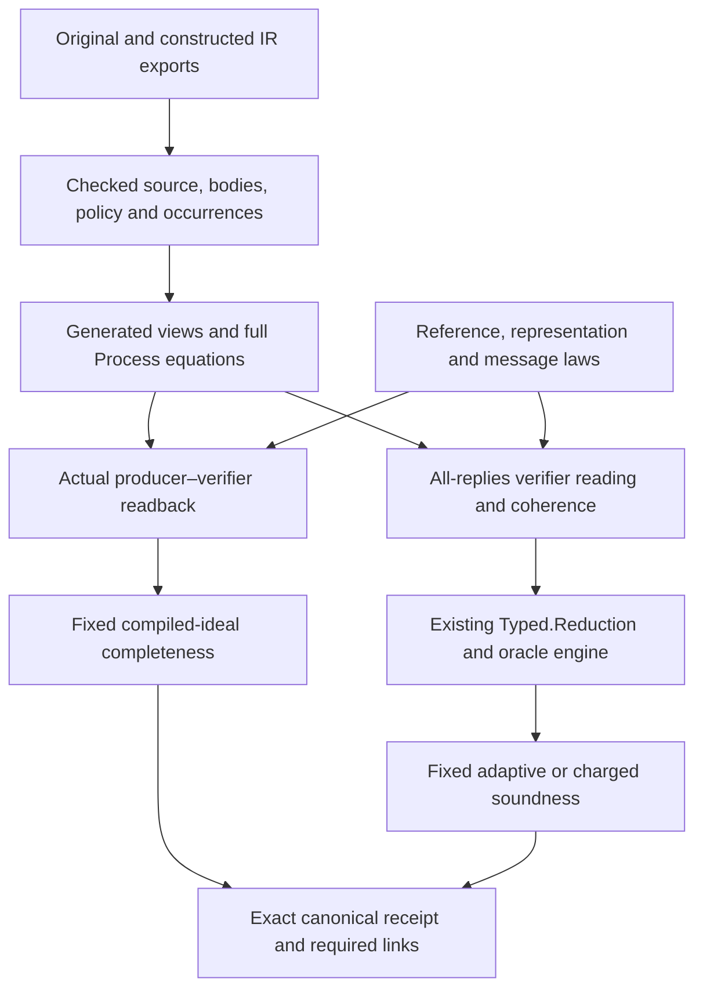

# Checked components and compiled claims

A component connects an actual imported open process to a mathematical
interface. Its process equation is independent of the property later proved.
Completeness and adversarial soundness consume that equation with different
premises; neither property changes the admitted program or the request's
meaning.

## Ownership

| Owner | Responsibility |
|---|---|
| `Zkc.Source.Structured` | Typed admission, source identity, complete helper and protocol bodies, normal forms and their soundness |
| `Zkc.Construction` | Constructed participant/pair admission, nominal values, execution, views and source-occurrence correspondence |
| `Zkc.Obligations` | Yes/No promises, contexts, frames and structural derivations without a probability dependency |
| `ZkcSecurity.Obligations` | Actual-distribution escape laws and interpretation into the existing reduction engine |
| `ZkcSecurity.Algebra` | Shared algebraic probability lemmas independent of a protocol family |
| `ZkcSecurity.Families` | Mathematical reference/message laws and reusable family consumers |
| `ZkcSecurity.Examples` | Exact source-body instances, selected subjects and root proof applications |
| `ZkcSecurity.Claims` | Request-owned models and canonical meanings, stage links and receipt admission |
| `ZkcTools`, `ZkcSecurity.Generation` and test generators | Candidate search and ordinary Lean source emission; their output must be checked |

The dependency audit rejects reusable family code importing source-specific
examples. A family can require a typed helper-law record; an example supplies
it by proving equations for the actual admitted bodies. Names, matching types
or hashes alone do not prove a helper's mathematical behavior.

## Generated binding and its scope

The Lean normalizer supplies the meaning of a generated view. The printer
emits ordinary definitions and applications of its soundness theorem. The
`structured-source component-bindings` command also emits a ledger indexed by
source occurrence and obligation responsibility. It does not execute Python
to construct its expression language. Python remains responsible for external
process orchestration, byte capture, report joins and retained older clients.

Binding equations preserve optional inputs and output masks, captures,
complete return values, callbacks, call contexts, bounded loops, effects and
stopped execution. Mathematical helper summaries are explicit checked
parameters; an unknown helper can remain opaque. Exact constructed views
retain the nominal sorts of every operand/result and the full producer and
validator instruction sequences.

For adversarial verification, `DomainReduction.ReadingTo` proves the endpoint
execution reading, while `CoherentTo` proves locality at the actual reached
history, including stopped outcomes. Their conjunction is the bridge into
`Typed.Reduction`. It preserves ordered oracle visits, repeated keys, arbitrary
stateful oracles and the unread-proof condition. It does not create a second
probabilistic evaluator or identify a cached oracle answer with a fresh coin.
Both bridge fields carry the same returned-state postcondition. Sequential
composition therefore asks for one continuation proof at the actual reached
history. Weakening forgets that postcondition on both fields together.

Source printers belong to the generation/tooling layer. Checked subjects may
import proof elaborators that construct kernel terms, but cannot import those
printers or their generation configuration. The dependency audit checks this
boundary transitively; a generated file is not an exception to the rule.

## Reference mathematics

`Families.Sumcheck.Reference` separates a remaining-round state, mathematical
total, round polynomial and restriction operation. `ReferenceLaws` requires
both a degree bound and closure under every next challenge, together with
boundary and evaluation equations. These are defined on admissible false
claims as well as true ones. A stopped honest execution is not a definition of
the mathematical reference.

`Message` supplies separate interpretation and degree laws for received
messages. The honest proof establishes that the actual sent message denotes
the reference. The soundness proof quantifies over all admitted messages and
uses the difference between their polynomial and the reference. Its local
probability bound refers to the actual sampling distribution. Uniform
finite-field root counting is one instance, not an assumption for every
challenge kind.

`ZkcSecurity.Algebra.Polynomial` owns the general univariate root and
agreement bounds. Sumcheck consumes those lemmas alongside its reference and
message laws. Other algebraic protocols can use the same probability library
without importing Sumcheck's reference semantics.

For table Sumcheck, `TableReference` uses the sum of the table after the current
prefix restriction. Shape closure justifies every subsequent restriction;
one-step even length is insufficient. For product references, factors are
restricted separately, preserving off-cube evaluations. The GKR round adapter
requires explicit independence of the inactive variable and the actual
caller table layout. A product of Boolean tables alone does not establish
that polynomial identity.

Joint-IR discovery proposes a reference and dependency cuts. It does not prove
representation, degree, freshness or target agreement. An explicitly supplied
reference follows the same checking path. Missing candidates remain
unresolved; they are not counterexamples. Comparison of discovery methods
must charge all mathematical laws, generators, configuration and source
correspondence work, including the producer proof needed by every method.

## Obligations and composition

`Token` has disjoint `Yes` and `No` predicates and permits a gap. Its safety
predicate is `not No`, which need not imply `Yes`. Facts may be reused; live
obligations may be removed only through a proved implication or the stated
stopping rule. A frame or call rule uses the actual returned state and history.

A derivation supplies local rules for guards, stops, calls, all-reply steps and
remaining-count loops. The core relative-adequacy theorem relates these Lean
proof objects to the abstract charged reading. It is not a decision procedure,
a finite certificate serialization theorem or complete automatic proof search.
The security interpretation separately proves each local escape bound and
reuses the existing oracle reduction theorem.

Budget composition is history-sensitive and positional. A shared challenge
does not automatically replace a sum by a maximum. A component's final
acceptance/false-state rule and the root's cost bound remain explicit. Charge
labels resolve to actual nominal source occurrences and dynamic coordinates;
unknown keys pay the declared fallback maximum. Repeated visits remain visits,
even when the oracle returns a cached value.

`derive_component_cost` assembles installed component bounds through return,
stop, bind and the actual conditional branches. Each continuation bound must
cover every returned value and reached history. The resulting proof uses the
existing charged walk semantics; an omitted component bound or an insufficient
requested total cannot produce a certificate. Both compiled table roots use
this composer.

`derive_component_rejection` composes installed residual contracts over the
same process structure. It carries their postconditions into continuations,
including the reached history. A missing admission premise may be split into
two cases, both of which require a kernel-checked derivation. Forgetting a
component only supplies the postcondition `True`; the final rejection obligation
must still follow from the other components. Propositional reasoning handles
false-child selection, while implementation-specific terminal laws remain at
the helper-realization boundary. The tactic never chooses a protocol by name.

Both compiled table roots use these shared cost and rejection composers.
Independent opaque-component controls reject an OR final check when only one
child is known false, a missing contract and a continuation law restricted to
the initial history. Source-driven generation now supplies both full validator presentations and
their bridges from admitted inputs and every discovered round. The checked
constructor preserves complete returned data and stopped paths.
`Generation.SumcheckSoundness` also generates the fixed security-subject export:
typed statement transport, rejection, cost, installation, schedule and canonical
scalar/charged consumers. Its budgets come from the retained loop maxima and
still require a checked cost derivation.

`compose_component_readback` assembles the honest producer–validator connection
from installed paired component rules. Each continuation receives the complete
returned representation and its invariant. A stopped execution, unknown component,
unproved side premise or false terminal condition cannot establish completion.
The table adapter uses the same discovered whole-body correspondences as the
adversarial view, retaining both environments and the shared history.

For the two actual table roots, `Generation.SumcheckCompleteness` derives input
projection and all occurrence setup from the admitted subject/pair. Configuration
selects domain carriers, sampling, a formula equation and a nonvacuity proof. It does
not supply captures, source offsets, loop counts or a root-specific proof script.
`prepare_target_readback` combines the checked policy and argument read with
that formula equation. `prove_retained_target` uses the same equation on the
adversarial side; there, all evaluation premises must follow from verifier
guards and component guarantees. Honest policy is not an adversary restriction.
The resulting generated theorems directly feed canonical receipts. Authors
supply formula mathematics, admissible witnesses and the selected library/domain
configuration. The two roots require no authored structural or security-subject
assembly. Tests retain independent target characterizations as controls; neither
root imports them. Shared tools, selection configuration and test work remain
part of the authoring-cost inventory.

`Generation.SumcheckInputs` traces each producer loop's initial table through
the def-use graph to propose a public reference input. This is an untrusted
hint: a helper may transform its input, so the generated execution and target
proofs must still validate the candidate. Ambiguous dependencies, unknown
sources and private tables remain unresolved. This bounded table-family search
is not a generic invariant-inference procedure.

Common root assembly is owned by `ZkcTools.StructuredSource.Root` and
`ZkcSecurity.Generation.RootCompleteness`. It emits the source-indexed subject,
actual ABI elimination, pair correspondence obligation and canonical endpoint;
the installed proof method supplies the mathematical obligations and their
proofs. `Generation.UniformRoot` is an opt-in presentation for a uniform scalar
and group interpretation. Mixed-domain clients need their own presentation;
the common shell does not identify all nominal fields or groups.

The Sigma installation uses generic module algebra and the same constructed
whole-process views. Its checked readback tactic aligns exact sends, receives,
public histories and owner-local draws. It derives the relation fact from the
retained formula and ABI argument selection. Unsupported formulas or process
shapes leave proof obligations; a protocol name never chooses a proof.
The randomized Schnorr, shared-challenge Schnorr AND and same-root alias client
select this installed method through configuration. They require no handwritten
ABI, subject, pair-equation or receipt wrapper. The mathematical installation,
its automation, source configuration and tests are still authoring work.

`bridges/structured/generate_component_roots.py` owns export capture and
orchestration for these clients. `roots/sampled.toml` selects sources, models and
installed methods. A direct probability proof can use the same subject and
receipt shell: SampledAbort proves its actual failure probability is exactly
`1 / cardinality(bls12-381.fr)` and that zero-error completeness is false.
Its admissible inputs impose no condition on the sampled coin. The driver is
an untrusted source printer, not a second semantic evaluator or receipt checker.
Use `--check` with a detached output directory to compare regenerated sources
and check the emitted proofs.

The maintained table-root producer is `security/checks/RunComponentRoots.lean`:
from `lean/security`, run `lake env lean --run checks/RunComponentRoots.lean
<output-directory>` after building the two generation configuration modules.
Freshness checking compares a detached output directory with the checked files;
running the printer alone does not check the emitted theorems.

## Fixed experiments and receipts

An honest subject fixes the original, actual compiled producer and validator,
retained relation, input clauses, typed input policy, output selector and
public-input mapping. Completeness requires a concrete admissible input
(nonvacuity) and bounds failure for every related admissible input. The
experiment runs both actual participants with one initially empty random-oracle
cache and counts input preparation failure, stops, decoding failures, rejection
and unread proof as failures. It has no adversary query parameter.

The canonical model `models.honest_fiat_shamir@1` installs fresh uniform
field draws at the actual producer's admitted owner-local service ports. The
source spelling remains `Random.draw()`. Service handles retain their source
root, owner, contract and native port position separately from data inputs.
Admission checks exact source occurrences, application aliases, nominal result
types and loop coordinates. Unsupported methods and validator-local requests
remain refused by the current admission rules.

`TranscriptOracle.Spec` is the shared public oracle interface. The honest
`HonestSampling.Spec` adds a uniform summand; it does not enlarge the adversary
interface. One outer ROM cache encloses both actual participants. Local draws
emit no public query event and preserve that cache. The shared interpreter
threads the returned service state across calls and participants. The installed
ideal sampler is stateless, while the interpreter also supports explicit
stateful service models. Native entropy and failure behavior require a separate
realization theorem.

The model accepts no evidence-selected sampler or `private_coins` parameter.
Private inputs remain fixed inputs. For pairs with no installed local service
ports, `SampledCompiled.computation_no_services` and
`HonestSampling.run_transcript` preserve the complete old experiment, including
its failures and final cache. A fixed public answer table leaves private draws
probabilistic. `SamplingPrefix` and `SampledReadback` prove producer-only sampled
prefixes followed by exact deterministic readback; each reached local request
must be authorized and every possible sampled continuation must succeed. This
is a sufficient proof method, not the definition of completeness. A direct
kernel proof may establish a nonzero failure bound for a sample-dependent
abort. Such a failure is not removed by a new honest-input premise.

The soundness projection reuses that subject's actual validator and retained
target. It does **not** inherit the honest input policy. Adaptive adversaries
may query before selecting any typed statement, including malformed table
shapes or out-of-range counts. Root proofs must handle those paths by their
actual verifier behavior. Scalar and charged bounds use `ENNReal`; their
request quantities and the carriers determining cardinalities are fixed before
evidence.

`CanonicalAuthority` recognizes the complete selected model, property and
subject shape. Receipt status depends on exact meaning, authorized telescope,
standard axioms and proved request-side links. Proof method or evidence
attribution never selects the meaning and may be `unattributed`. An author
extension is reported separately from a canonical security property.

Authored-pair selection currently has a typed Lean request API. Its source
language declaration surface remains a coordinated language decision; the
validator-only source-claim artifact binder is not an authored-pair binder.
Compiled-ideal completeness does not establish byte-level completeness or the
aggregate deployed authored-pair certification.

## Model and implementation boundaries

Nominal domain carriers remain distinct through payloads, statements, replies,
histories and requests. Algebra and embedding laws are proved against the
actual operational model. A field's cardinality is derived from its carrier;
an extension field does not inherit its base field's size. Model admission
checks the exported catalogue and fixed capability package.

Heterogeneous mathematical controls include a sampled proximity test with a
genuine promise gap and a sampled relaxed quadratic fold. The fold's charged
derivation covers either false input, preserves the private residual and caller
frame, and composes with a final residual decider. These exercise the generic
derivation interface; they are not compiled FRI/STARK, commitment, extraction or
recursion endpoints. The complete generated table roots establish completeness
and adversarial scalar/charged soundness. The separate randomized Sigma roots
establish compiled-ideal completeness; these new artifacts have no new
knowledge-soundness or zero-knowledge certification. Existing maintained
Sigma security receipts concern their own fixed artifacts and games.

The source-bound polynomial restriction helper uses coefficient storage of
length four, then two, then one. Its checked source-body equation and caller
frame proof instantiate the existing Sumcheck representation laws. Closure
covers arbitrary field challenges and future restrictions, including off-cube
evaluation. Boolean-cube agreement alone is rejected. This is a real helper and
caller demonstration, not a second full compiled Sumcheck producer. The matched
manual/verifier-only/joint-IR author-cost experiment remains separate; no
measured author-effort reduction follows from these installation examples.

Proof-search failure diagnostics retain failed mathematical premises and kernel
errors. Lean's tagged elaborator resource errors propagate through ordinary
catch clauses; kernel timeouts arrive as ordinary diagnostics and remain in the
reported candidate failures. Resource exhaustion is unresolved proof search,
never a semantic counterexample or a successful refusal control.

These theorems concern interpreted IR and selected exact exports. The native
frontend/exporter association remains an explicit trusted source link until
proved separately. Native codecs/arithmetic, deployed transcript bytes,
computational commitment security, QROM security, knowledge extraction and
full GKR circuit-output acceptance require their own results. Source mutations
and finite experiments test boundaries but do not establish those results.
