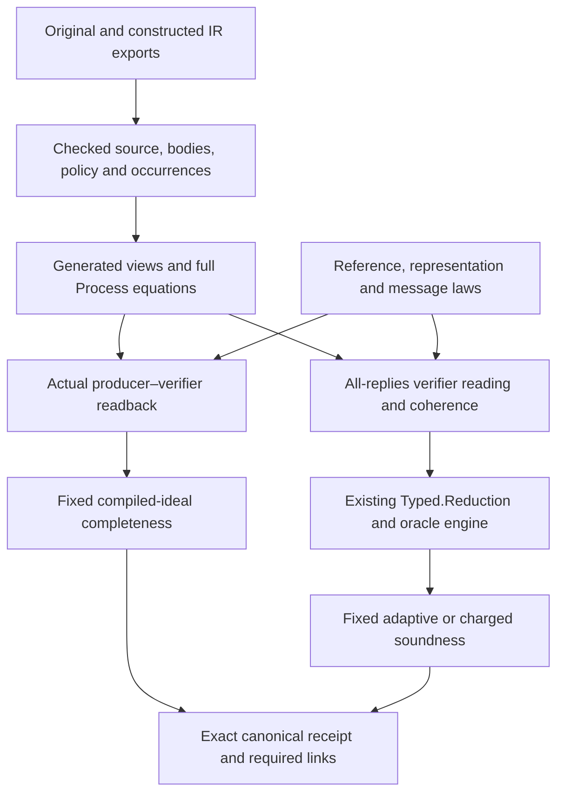

# Checked components and compiled claims

A component connects an actual imported open process to a mathematical
interface. Its process equation is independent of the property later proved.
Completeness and adversarial soundness consume that equation with different
premises; neither property changes the admitted program or the request's
meaning.

## Ownership

| Owner | Responsibility |
|---|---|
| `Zkc.Source.Structured` | Typed admission, source identity, complete helper and protocol bodies, normal forms and their soundness |
| `Zkc.Construction` | Constructed participant/pair admission, nominal values, execution, views and source-occurrence correspondence |
| `Zkc.Obligations` | Yes/No promises, contexts, frames and structural derivations without a probability dependency |
| `ZkcSecurity.Obligations` | Actual-distribution escape laws and interpretation into the existing reduction engine |
| `ZkcSecurity.Algebra` | Shared algebraic probability lemmas independent of a protocol family |
| `ZkcSecurity.Families` | Mathematical reference/message laws and reusable family consumers |
| `ZkcSecurity.Realizations` | Checked laws for concrete source implementations, under the subject-level dependency boundary |
| `ZkcSecurity.Examples` | Exact source-body instances, selected subjects and root proof applications |
| `ZkcSecurity.Claims` | Request-owned models and canonical meanings, stage links and receipt admission |
| `ZkcTools`, `ZkcSecurity.Generation` and test generators | Candidate search and ordinary Lean source emission; their output must be checked |

The dependency audit rejects reusable family code importing source-specific
examples. A family can require a typed helper-law record; an example supplies
it by proving equations for the actual admitted bodies. Names, matching types
or hashes alone do not prove a helper's mathematical behavior.

## Generated binding and its scope

The Lean normalizer supplies the meaning of a generated view. The printer
emits ordinary definitions and applications of its soundness theorem. The
`structured-source component-bindings` command also emits a ledger indexed by
source occurrence and obligation responsibility. This is a proposal inventory,
not evidence that its open rows were discharged. It does not execute Python
to construct its expression language. Python remains responsible for external
process orchestration, byte capture, report joins and retained older clients.

For the installed table method, `python3
lean/security/checks/check_derivation_accounts.py` emits a separate discharge
account from the actual SmallSumcheck and TwoSums charged receipts.
`ZkcTools.ProofAccount` inspects applications in checked declaration bodies;
the method defines its checkpoints once in
`ZkcSecurity.Generation.SumcheckAccounts`. Initialization, preservation, exit,
frame and terminal rows retain their selected proof terms, inferred types,
complete local telescopes, dependency paths and source occurrences. Root
applications bind actual schedules, raw inputs, claims and round counts;
TwoSums records both composition branches and the reached history. Authored
target mathematics, sampling and cost are recorded separately. A shared
library application is counted once and referenced by its occurrences.

Responsibility and method labels are measurement annotations. Syntactic
reachability is not a minimal semantic dependency analysis. Missing, ambiguous
or stale associations fail this measurement; they never invalidate an otherwise
valid receipt. Direct proofs may remain unattributed. The account does not
promote rows in the proposal inventory or claim to account for every possible
proof method. Call association checks the full typed equation, not merely the
presence of declaration names. The driver pins project import sources and the
objects directly encountered from those imports, including external objects;
it does not inventory external packages' transitive object closure. Object bytes
and source bytes are recorded separately. It requires prepared package
dependencies and is not a fresh build.

Binding equations preserve optional inputs and output masks, captures,
complete return values, callbacks, call contexts, bounded loops, effects and
stopped execution. Mathematical helper summaries are explicit checked
parameters; an unknown helper can remain opaque. Exact constructed views
retain the nominal sorts of every operand/result and the full producer and
validator instruction sequences.

The nominal source interpreter also supports optional iteration observations.
`Occurrence.participant` uses the same admitted helper and protocol bodies and
records each reached repeat site and induction index. Call-site qualification,
role substitution, masks and callback captures remain those of the original
interpreter. `Occurrence.participant_erase` proves equality with
`Program.participantOn` after erasing iteration boundaries, for all inputs and
provider responses. A stopped callback emits no closing boundary and runs no
later iteration. Silent instrumentation is definitionally the existing meaning.
These are source-view laws; construction transport and dynamic transcript-key
agreement still require their own correspondence proofs.

`DomainInterpretation` and `DomainParticipantInterpretation` provide the
effect-interpretation laws over the actual nominal domain model and captured
helper/protocol prefixes. `Domain.Binding` pair transport quantifies the selected
private-service handler as well as the public oracle. It preserves their actual
shared post-state, stopped prefixes, proof buffers and returned ABI values.

The original-component route separates three checked equations:

1. `Occurrence.participant_erase` recovers the admitted original participant.
2. `Original.fold` constructs that participant's public transcript and private
   service effects. `OccurrenceResolution` checks the exact source path and
   reached iteration stack. Producer challenge delivery additionally requires
   `SourceDelivery.checked`, which follows the original draw's unchanged SSA
   result to its first exchange; equality of field values is insufficient. The
   synchronous construction permits only visibility restrictions in that
   window and requires the unique draw/delivery pair in the fixed policy.
   Repeated delivery and intervening messages refuse. Supporting those schedules
   would require preserving draw-time history and reusing the sampled value;
   re-querying at each receive is not equivalent. Sharing one delivered value
   among local component consumers does not require repeated delivery.
3. An `Original.Simulation` connects the constructed original to the selected
   artifact through return, stop, effect, checkpoint, sequence and repeat rules.
   Validator and producer certificates are separate. The fixed consumer supplies
   their complete return relation and live-frame obligations before proof search.

The simulation produces a paired view retaining both original and artifact
returns. Its target projection equals the actual artifact process, including
every physical checkpoint. Its source projection erases those checkpoints and
equals the original construction. `Original.Simulation.source_run_interaction` lifts that
source projection through the same runtime handler, preserving outcome, unread
proof, oracle and local-service post-state, and ordered events. It names the
frame abstraction explicitly: raw original frames and compiled SSA frames are
not asserted equal. `Original.executePair_eq` transports the independent role
certificates through the existing pair experiment and its shared post-state.

These rules quantify over arbitrary replies and stopped prefixes. A syntactically
admitted producer with an added false guard need not have a correspondence
certificate. A certificate with an arbitrary weak return relation also does not
supply a fixed claim's stronger ABI obligation. The source equation, artifact
equation and mathematical family contract must all meet at the same consumer.
An installed source body's realization belongs with implementation bindings;
the abstract mathematical family must not import the selected example roots.

The property consumers reuse this full simulation in two ways.
`Readback.original` transports an honest source interaction through independent
producer and validator simulations, retaining both full return relations. The
existing completeness theorem then interprets that interaction in the shared
oracle-cache experiment and counts every failure outcome. Soundness instead
transports an all-reply source reading, its rejection derivation and its
history-dependent cost into the existing charged endpoint. An honest input
contract supplies completeness premises; it never restricts the adversary.

A nominal reading may erase information that remains in the artifact's final
SSA environment. Therefore acceptance agreement alone cannot construct the
full-result presentation required by a charged receipt. `LosslessInterface`
states the local reply laws that suffice: receive and query reply maps are
bijective, received values have a proof-payload representation, and a send has
only its selected reply. The actual field interface proves these laws once,
including nominal field identity and the exact decoded payload. The generic
transport then reconstructs the target presentation, preserves the source
postcondition, and transfers the same rejection derivation and cost bound. It
does not require the final environment to be a function of the source's final
return value. A collapsing decoder or an unreachable extra send reply fails
these laws. Such an interface needs an explicit different realization; it does
not receive a weaker receipt.

Generated callee dispatch uses one checked actual-callee table and dependent
updates for selected views. All roles of a declaration see the completed table
of earlier declarations; omitted views keep their actual invocation. This
preserves sparse selections, role remapping and private output masks without
repeating the full dispatch catalogue per role. The printer shares key type
expressions as well. This removes quadratic full-table source duplication; it
does not establish a linear elaboration-time bound. Unsupported constructed
operations retain a stable diagnostic code together with their exact nested
source path, operation, operands, sorts and body size.

The maintained structured-binding check compiles dense, sparse, root-only and
empty-selection outputs and tests catalogue growth. The security scope compiles
fresh ABI installations and rejects incorrect argument orders, conditions and
nonvacuity evidence. These checks exercise printer output, not just hand-written
lookalike declarations.

For adversarial verification, `DomainReduction.ReadingTo` proves the endpoint
execution reading, while `CoherentTo` proves locality at the actual reached
history, including stopped outcomes. Their conjunction is the bridge into
`Typed.Reduction`. It preserves ordered oracle visits, repeated keys, arbitrary
stateful oracles and the unread-proof condition. It does not create a second
probabilistic evaluator or identify a cached oracle answer with a fresh coin.
Both bridge fields carry the same returned-state postcondition. Sequential
composition therefore asks for one continuation proof at the actual reached
history. Weakening forgets that postcondition on both fields together.

Source printers belong to the generation/tooling layer. Checked subjects may
import proof elaborators that construct kernel terms, but cannot import those
printers or their generation configuration. The dependency audit checks this
boundary transitively; a generated file is not an exception to the rule.

## Reference mathematics

`Families.Sumcheck.Reference` separates a remaining-round state, mathematical
total, round polynomial and restriction operation. `ReferenceLaws` requires
both a degree bound and closure under every next challenge, together with
boundary and evaluation equations. These are defined on admissible false
claims as well as true ones. A stopped honest execution is not a definition of
the mathematical reference.

`Message` supplies separate interpretation and degree laws for received
messages. The honest proof establishes that the actual sent message denotes
the reference. The soundness proof quantifies over all admitted messages and
uses the difference between their polynomial and the reference. Its local
probability bound refers to the actual sampling distribution. Uniform
finite-field root counting is one instance, not an assumption for every
challenge kind.

`ZkcSecurity.Algebra.Polynomial` owns the general univariate root and
agreement bounds. Sumcheck consumes those lemmas alongside its reference and
message laws. Other algebraic protocols can use the same probability library
without importing Sumcheck's reference semantics.

For table Sumcheck, `TableReference` uses the sum of the table after the current
prefix restriction. Shape closure justifies every subsequent restriction;
one-step even length is insufficient. For product references, factors are
restricted separately, preserving off-cube evaluations. The GKR round adapter
requires explicit independence of the inactive variable and the actual
caller table layout. A product of Boolean tables alone does not establish
that polynomial identity.

Joint-IR discovery proposes a reference and dependency cuts. It does not prove
representation, degree, freshness or target agreement. An explicitly supplied
reference follows the same checking path. Missing candidates remain
unresolved; they are not counterexamples. Comparison of discovery methods
must charge all mathematical laws, generators, configuration and source
correspondence work, including the producer proof needed by every method.

## Obligations and composition

`Token` has disjoint `Yes` and `No` predicates and permits a gap. Its safety
predicate is `not No`, which need not imply `Yes`. Facts may be reused; live
obligations may be removed only through a proved implication or the stated
stopping rule. A frame or call rule uses the actual returned state and history.

A derivation supplies local rules for guards, stops, calls, all-reply steps and
remaining-count loops. The core relative-adequacy theorem relates these Lean
proof objects to the abstract charged reading. It is not a decision procedure,
a finite certificate serialization theorem or complete automatic proof search.
The security interpretation separately proves each local escape bound and
reuses the existing oracle reduction theorem.

Budget composition is history-sensitive and positional. A shared challenge
does not automatically replace a sum by a maximum. A component's final
acceptance/false-state rule and the root's cost bound remain explicit. Charge
labels resolve to actual nominal source occurrences and dynamic coordinates;
unknown keys pay the declared fallback maximum. Repeated visits remain visits,
even when the oracle returns a cached value.

`derive_component_cost` assembles installed component bounds through return,
stop, bind and the actual conditional branches. Each continuation bound must
cover every returned value and reached history. The resulting proof uses the
existing charged walk semantics; an omitted component bound or an insufficient
requested total cannot produce a certificate. Installed clients may use this tactic or apply the same composition rules
directly.

`derive_component_rejection` composes installed residual contracts over the
same process structure. It carries their postconditions into continuations,
including the reached history. A missing admission premise may be split into
two cases, both of which require a kernel-checked derivation. Forgetting a
component only supplies the postcondition `True`; the final rejection obligation
must still follow from the other components. Propositional reasoning handles
false-child selection, while implementation-specific terminal laws remain at
the helper-realization boundary. The tactic never chooses a protocol by name.

The table source realization applies the same generic bind and cost rules.
Independent opaque-component controls reject an OR final check when only one
child is known false, a missing contract and a continuation law restricted to
the initial history. Neither these rules nor their optional proof tactics select
a protocol by name.

For SmallSumcheck and TwoSums, the production binding starts at the admitted
original `Reduce`, its actual helper bodies and its original callback. The
source contract and its mathematical reference do not name a compiled round
length. Each call supplies its checked original context, substitution and
occurrence schedule. The complete original root is assembled in source order;
TwoSums runs the second call even when the first terminal returns false, and
combines the returned values only afterwards. A stop suppresses exactly the
remaining suffix.

Soundness uses an all-input source presentation. Table shape, scalar truth,
capacity and round limits are cases in its proof, not restrictions on the
adversary. Excessive counts retain the actual refusal; malformed tables retain
the preceding interactions and actual terminal failure. Source and artifact
bindings preserve the six optional Reduce results and the actual final result
and environment. The two unchanged validator charge budgets are 2 and 8.
The field's sampling and reference laws supply the per-query escape charge;
the ordinary `Claims.Domain.ChargedExport` and existing compiled-soundness
consumers supply the fixed scalar and charged meanings.

Completeness has an additional original producer proof, with retained source
input clauses, ABI admission and the source relation as premises. Its round induction uses
the same table restriction mathematics as adversarial soundness and covers
zero rounds and arbitrary public challenge replies. Source readback transports
through the two independent artifact simulations into the actual registered
pair. The existing honest experiment supplies the single oracle cache, exact
proof consumption and failure accounting. A verifier simulation alone cannot
establish completeness.

`Generation.Roots.Catalogue` owns the selected sources, actual pairs, targets,
domains and mathematical installations. Generators derive source aliases,
occurrence schedules, ABI positions, artifact loop metadata and structural
instantiations from these admitted selections. Output references are data of
the actual selected artifact, not facts about the mathematical family.
Candidate source assembly, artifact correspondence and receipt instantiation
remain ordinary Lean terms that must check. Unsupported source compositions
refuse; this is an installed family route, not automatic theorem discovery for
every protocol.

`prepare_target_readback` combines the checked policy and argument read with
the authored formula equation. `prove_retained_target` uses the same equation
on the adversarial side, where every premise must follow from verifier guards
and component guarantees. Formula mathematics, representation laws and a new
library realization remain author work. Source, target, domain and installed-law
selections are instantiation work even when stored in a production catalogue.
Generated size, generator implementation and checking cost are recorded
separately; generating a wrapper does not eliminate an upstream handwritten
proof obligation.

The two table roots retain verifier-side input clauses for exact power-of-two
table lengths and their source maximum. `Subject.HonestInput` combines every
retained input clause with source-sort representability and preparation of both
participants. It does not take a separately registered table policy. Historical
policies live only in migration tests: all-input equivalence and positive
inhabitation must check against the actual imported subjects. Other roots can
have a stricter representability boundary than their former empty policy; no
universal old/new equivalence is asserted. Changed source, target and model
identities require newly issued requests and checked receipts.

`Generation.Roots.Stages` owns production completeness and soundness generation.
The superseded compiled-descriptor generators and their exclusive round/view
fixtures have been removed. `Families.Sumcheck.CompiledRound` remains part of
the reusable table readback library. The maintained interpreted-bytes Sumcheck
leaf proves a different stage's claim and remains supported until its stage
transport and claim-preservation obligations are discharged.

Common root assembly is owned by `ZkcTools.StructuredSource.Root` and
`ZkcSecurity.Generation.RootCompleteness`. It emits the source-indexed subject,
actual ABI elimination, pair correspondence obligation and canonical endpoint;
the installed proof method supplies the mathematical obligations and their
proofs. `Generation.UniformRoot` is an opt-in presentation for a uniform scalar
and group interpretation. Mixed-domain clients need their own presentation;
the common shell does not identify all nominal fields or groups.

The common ABI separates distinct source-coordinate parameters from ordered
relation-selector payloads. Payload order and repeated selectors are preserved;
empty public rows use their unique packed value without an empty existential.
Retained input clauses stay in `honestInput_iff` together with source-sort ABI
representability. These premises check u64 indices and collection lengths,
including every member of nested products and sequences. They do not grant
native ABI support: the current uniform ABI generator still explicitly refuses
aggregate input types. An optional clause presentation must prove equivalence to the exact
retained clauses for every source input. Without it, the generated condition is
the actual clause conjunction.

`Tools.SourceInputClauses` produces ordinary kernel-checked simplification proofs
from the retained formulas. Optional presence is distinct from representability:
an absent input cannot satisfy an accidentally simplified clause. The current
uniform ABI presentation explicitly refuses data inputs covered by neither the
producer nor public projection, rather than silently requiring their presence
in the subject's meaning. This is a presentation limit, not a security premise.

Installed Sigma methods may supply a term checked as `Nonvacuous subject` and
imports for that term. The default still proposes the all-default witness and
fails if the fixed conditions do not admit it. A missing or incorrect law never
becomes an assumption or an established claim. In the source-root descriptor,
`method_imports` and `nonvacuity_law` select this checked installation evidence;
they do not choose the subject's relation, input conditions, or experiment.

The Sigma installation uses generic module algebra and the same constructed
whole-process views. Its checked readback tactic aligns exact sends, receives,
public histories and owner-local draws. It derives the relation fact from the
retained formula and ABI argument selection. Unsupported formulas or process
shapes leave proof obligations; a protocol name never chooses a proof.
The randomized Schnorr, shared-challenge Schnorr AND, same-root alias client
and sequential Schnorr/Chaum–Pedersen client select this installed method through
configuration. The sequential client requires a fresh private nonce after the
first component's public challenge and response. They require no handwritten
ABI, subject, pair-equation or receipt wrapper. The mathematical installation,
its automation, source configuration and tests are still authoring work.

`bridges/structured/generate_component_roots.py` owns export capture and
orchestration for these clients. `roots/sampled.toml` selects sources, models and
installed methods. A direct probability proof can use the same subject and
receipt shell: SampledAbort proves its actual failure probability is exactly
`1 / cardinality(bls12-381.fr)` and that zero-error completeness is false.
Its admissible inputs impose no condition on the sampled coin. The driver is
an untrusted source printer, not a second semantic evaluator or receipt checker.
Use `--check` with a detached output directory to compare regenerated sources
and check the emitted proofs.

Reusable laws for the installed table implementation live in
`ZkcSecurity.Realizations.Sumcheck`. `DomainHelpers.Bodies` checks exact source
bodies and dependencies; `ReadbackHelpers` and `ValidatorHelpers` give honest
and arbitrary-input terminal laws for that implementation. Roots reuse these
laws by proving body membership, rather than reproving arithmetic or selecting
helpers by name. The family reduction remains independent of these source
realizations. Another implementation must provide its own checked realization;
a different representation does not become correct merely by selecting this
installation.

The maintained table-root producer is `security/checks/RunComponentRoots.lean`:
from `lean/security`, run `lake env lean --run checks/RunComponentRoots.lean
<output-directory>` after building the two generation configuration modules.
Freshness checking compares a detached output directory with the checked files;
running the printer alone does not check the emitted theorems.

## Fixed experiments and receipts

An honest subject fixes the original, actual compiled producer and validator,
retained relation, source input clauses and ABI admission, output selector and
public-input mapping. Completeness requires a concrete admissible input
(nonvacuity) and bounds failure for every related admissible input. The
experiment runs both actual participants with one initially empty random-oracle
cache and counts input preparation failure, stops, decoding failures, rejection
and unread proof as failures. It has no adversary query parameter.

The canonical model `models.honest@0(producer=producers.compiled@0())` resolves
to the subject's actual selected compiled producer and installs fresh uniform
field draws at the actual producer's admitted owner-local service ports. The
source spelling remains `Random.draw()`. Service handles retain their source
root, owner, contract and native port position separately from data inputs.
Admission checks exact source occurrences, application aliases, nominal result
types and loop coordinates. Unsupported methods and validator-local requests
remain refused by the current admission rules.

The compiled schema requires exactly that producer argument. Source-role,
author-supplied and independently named artifacts, level overrides and retries
are refused. The previous model name has no alias. Canonical admission checks
the complete registered export, including its `zkc.model.honest/0` schema and
definition. The model decoder and encoder have roundtrip and accepted-wire
equality theorems.

Property parameters have separate typed schemas in `Claims.Parameters`.
`completeness@0` and `knowledge@0` accept only an absent field. Knowledge keeps
the registered response-difference extractor fixed; there is no extractor
parameter or guarantee argument at version zero. `soundness@0` accepts either
absence (the existing exact soundness) or one
`gaps.relative_distance@0(delta)` expression. Its decoder resolves arithmetic
and admitted field cardinalities in Lean and requires a rational in `[0, 1]`.
Canonical encoding preserves the exact finite numeric expression; equivalent
arithmetic spellings remain different request identities. Unknown versions,
duplicate arguments, nonnumeric values and conflicting request fields refuse.
Unresolved registered cardinalities remain incomplete. No current equality-only
clause registers a relative-distance interpretation, so every present gap
remains incomplete with the selected clause named in the diagnostic. Evidence
cannot supply a gap predicate or substitute exact soundness.

The default soundness and honest adapters share a conservative relation
dependency check. It follows exact checked helper signatures through every
nested callback, admitting pure Math and refusing executable primitives,
observations, missing helpers, duplicates and cycles. The honest adapter checks
both its selected target and every input formula. This is an applicability
restriction; it supplies no security theorem. The current compiled experiment
supports the transcript oracle and owner-local field draws. General realization
role primitives require an extension of that experiment and its correspondence;
the present schema does not silently give them deterministic meanings.

`TranscriptOracle.Spec` is the shared public oracle interface. The honest
`HonestSampling.Spec` adds a uniform summand; it does not enlarge the adversary
interface. One outer ROM cache encloses both actual participants. Local draws
emit no public query event and preserve that cache. The shared interpreter
threads the returned service state across calls and participants. The installed
ideal sampler is stateless, while the interpreter also supports explicit
stateful service models. Native entropy and failure behavior require a separate
realization theorem.

The model accepts no evidence-selected sampler or `private_coins` parameter.
Private inputs remain fixed inputs. For pairs with no installed local service
ports, `SampledCompiled.computation_no_services` and
`HonestSampling.run_transcript` preserve the complete old experiment, including
its failures and final cache. A fixed public answer table leaves private draws
probabilistic. `SamplingPrefix` remains a convenience for producer-private
prefixes. `SampledReadback` also permits authorized private draws between exact
sends/receives, public queries, observations and checkpoints. Its bind rule
composes over the actual returned values and their relation; finite repetition
uses the same rule. Every reached local request must be authorized and every
typed continuation must succeed. The service-return law applies to supported
outcomes and retains the actual private post-state. The validator consumes the
producer's exact proof with any suffix preserved; both participants use the same
public table, lifted through the existing single outer ROM cache. This remains
a sufficient proof method, not the definition of completeness. A direct
kernel proof may establish a nonzero failure bound for a sample-dependent
abort. Such a failure is not removed by a new honest-input premise.

The soundness projection reuses that subject's actual validator and retained
target. It does **not** inherit the honest input policy. Adaptive adversaries
may query before selecting any typed statement, including malformed table
shapes or out-of-range counts. Root proofs must handle those paths by their
actual verifier behavior. Scalar and charged bounds use `ENNReal`; their
request quantities and the carriers determining cardinalities are fixed before
evidence.

`CanonicalAuthority` recognizes the complete selected model, property and
subject shape. Receipt status depends on exact meaning, authorized telescope,
standard axioms and proved request-side links. Proof method or evidence
attribution never selects the meaning and may be `unattributed`. An author
extension is reported separately from a canonical security property.
Lean's `Claims.ReceiptAudit` computes the final status from the complete finite
audit envelope. The export rechecks actual declaration types, telescopes, axioms
and required links in each provider's own import environment. Python checks the
transport identity and joins and renders these decisions; missing or malformed
exports do not select a weaker audit. Attribution remains best effort and does
not affect establishment.

Authored-pair selection currently has a typed Lean request API. Its source
language declaration surface remains a coordinated language decision; the
validator-only source-claim artifact binder is not an authored-pair binder.
Compiled-ideal completeness does not establish byte-level completeness or the
aggregate deployed authored-pair certification.
The maintained `sumcheck` leaf retains its interpreted executable-bytes claim.
The compiled-ideal component route cannot replace it until the corresponding
stage transport and claim preservation are established. Report these as two
routes of one protocol, with their distinct stages and assumptions.

## Model and implementation boundaries

Nominal domain carriers remain distinct through payloads, statements, replies,
histories and requests. Algebra and embedding laws are proved against the
actual operational model. A field's cardinality is derived from its carrier;
an extension field does not inherit its base field's size. Model admission
checks the exported catalogue and fixed capability package.

Heterogeneous mathematical controls include a sampled proximity test with a
genuine promise gap and a sampled relaxed quadratic fold. The fold's charged
derivation covers either false input, preserves the private residual and caller
frame, and composes with a final residual decider. These exercise the generic
derivation interface; they are not compiled FRI/STARK, commitment, extraction or
recursion endpoints. The complete generated table roots establish completeness
and adversarial scalar/charged soundness. The separate randomized Sigma roots
establish compiled-ideal completeness; these new artifacts have no new
knowledge-soundness or zero-knowledge certification. Existing maintained
Sigma security receipts concern their own fixed artifacts and games.

The source-bound polynomial restriction helper uses coefficient storage of
length four, then two, then one. Its checked source-body equation and caller
frame proof instantiate the existing Sumcheck representation laws. Closure
covers arbitrary field challenges and future restrictions, including off-cube
evaluation. Boolean-cube agreement alone is rejected. This is a real helper and
caller demonstration, not a second full compiled Sumcheck producer. The matched
manual/verifier-only/joint-IR author-cost experiment remains separate; no
measured author-effort reduction follows from these installation examples.

Proof-search failure diagnostics retain failed mathematical premises and kernel
errors. Lean's tagged elaborator resource errors propagate through ordinary
catch clauses; kernel timeouts arrive as ordinary diagnostics and remain in the
reported candidate failures. Resource exhaustion is unresolved proof search,
never a semantic counterexample or a successful refusal control.

These theorems concern interpreted IR and selected exact exports. The native
frontend/exporter association remains an explicit trusted source link until
proved separately. Native codecs/arithmetic, deployed transcript bytes,
computational commitment security, QROM security, knowledge extraction and
full GKR circuit-output acceptance require their own results. Source mutations
and finite experiments test boundaries but do not establish those results.
